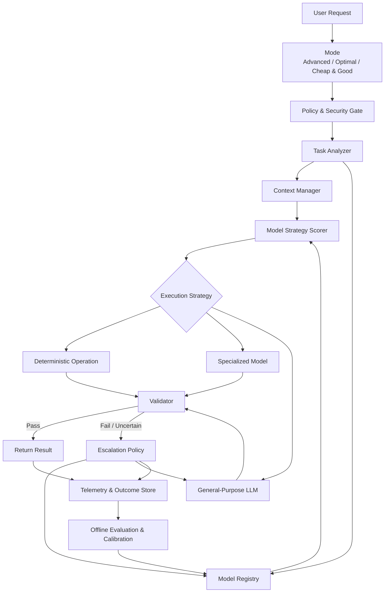
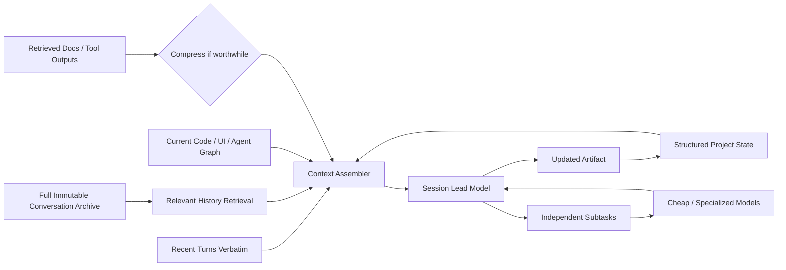
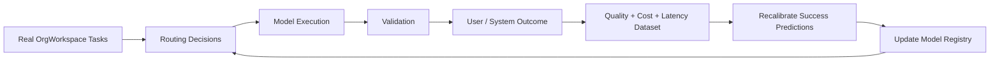

# OrgWorkspace Smart Model Selection Engine: Deep Research and Recommended Architecture

## Executive summary

OrgWorkspace has a credible opportunity to build a **Smart Model Selection Engine** around three user-facing modes:

| User mode | What the user is really asking for | Engine objective |
|---|---|---|
| **Advanced** | “Give me the best result; quality matters more than cost.” | Maximize successful task completion and reliability |
| **Optimal** | “Give me a very good result without wasting money.” | Minimize expected total cost subject to a high quality threshold |
| **Cheap & Good** | “Keep this inexpensive, but don't give me garbage.” | Minimize cost subject to an explicit minimum quality floor |

The most important architectural principle is that **these modes should not map directly to three models**. “Advanced = expensive model,” “Optimal = medium model,” and “Cheap & Good = cheap model” would leave much of the value on the table.

Instead:

> **The user chooses the desired outcome. OrgWorkspace chooses the execution strategy.**

That strategy can include deterministic operations, specialized decision/extraction/summarization models, a general-purpose LLM, prompt caching, task decomposition, validation, and conditional escalation.

There is substantial evidence that model routing can lower inference cost without proportionally lowering quality. RouteLLM reported more than a 2× cost reduction in some benchmark settings without sacrificing response quality; FrugalGPT reported up to 98% cost reduction on selected historical tasks using learned cascades; and Amazon says Bedrock Intelligent Prompt Routing can reduce costs by up to 30% while maintaining accuracy. These are **benchmark or provider results, not forecasts for OrgWorkspace**, but they demonstrate that the underlying optimization problem is real. citeturn22search0turn22search1turn23search2

For OrgWorkspace specifically, I would **not initially build a sophisticated learned router**. The better MVP is:

**policy filtering → task classification → capability filtering → model scoring → execution → deterministic validation where possible → conditional escalation → telemetry → continuous evaluation.**

That gives you most of the architectural foundation while creating the data necessary to train a better router later.

The other major conclusion is that **model routing and context management must be designed together**. Your agent-builder and UI-builder conversations involve long iterative sessions where users refine requirements over many turns. Constantly switching models or aggressively compressing conversation history can damage continuity. For these workloads, the engine should maintain a “lead model,” structured project state, recent verbatim conversation, prompt-cache affinity, and an immutable conversation archive. Specialized compression should primarily reduce large tool responses, retrieved documents, logs, and other reconstructable context rather than replace the canonical project memory. OpenRouter already uses provider-sticky routing to improve prompt-cache reuse, while current OpenAI models offer very large cached-input discounts, making caching an important part of the economics. citeturn20search2turn21search1

My recommended target architecture is therefore:

```text
User preference
       ↓
Advanced / Optimal / Cheap & Good
       ↓
OrgWorkspace policy + task understanding
       ↓
Capability-aware model portfolio
       ↓
Execution strategy
       ↓
Validate
   ↙       ↘
accept    escalate
             ↓
        stronger model
             ↓
          validate
             ↓
           result
```

**The economic thesis:** the largest opportunity is not merely paying less per token. It is improving **cost per successful task** by preventing expensive models from doing trivial work, preventing weak models from repeatedly failing difficult work, using specialized models where appropriate, preserving caches, and escalating only when there is evidence that escalation is necessary.

Because OrgWorkspace's traffic volume, existing model mix, average prompt size, SLA targets, user retry rates, current cache hit rate, and engineering cost are unspecified, all financial scenarios below are explicitly illustrative assumptions rather than estimates of current OrgWorkspace spend.

## Strategic effectiveness and business case

The Smart Model Selection Engine can create value through several mechanisms simultaneously. Cost reduction is the most obvious, but it is not necessarily the most valuable.

A useful definition of the engine's objective is:

\[
\text{Value} =
\frac{\text{Successful user outcomes}}
{\text{Model cost + retry cost + latency cost + failure cost}}
\]

That framing is much better than simply minimizing dollars per request.

A \$0.003 model call that fails three times and eventually requires a \$0.30 model is not necessarily cheaper than starting with a \$0.06 model. Conversely, sending “rename this button” to the most capable frontier model simply because the user selected Advanced is wasteful.

### How effective can routing realistically be?

The research literature supports the premise that model heterogeneity can be exploited economically.

RouteLLM trains routers using preference data and reported more than a 2× cost reduction in certain benchmark scenarios while preserving response quality. citeturn22search0turn22search4 FrugalGPT's cascade experiments found that, on its tested datasets and older model portfolio, it could match the best individual LLM with savings as high as 98%, or improve accuracy by roughly 4% at similar cost. Those results are unusually strong and task-specific, so they should be interpreted as proof of possibility rather than an expected OrgWorkspace outcome. citeturn22search1turn22search21

RouterBench was created specifically because routing performance varies substantially by workload; it contains more than 405,000 model inference outcomes. A newer LLMRouterBench contains more than 400,000 instances from 21 datasets, 33 models, and ten routing baselines. The existence and scale of these benchmarks reinforces an important lesson: **routing itself must be evaluated like a model; it should not be assumed to work merely because a router has been implemented.** citeturn22search2turn22search3

There are also commercial precedents. Amazon Bedrock's Intelligent Prompt Routing predicts which model is likely to provide sufficient quality while optimizing cost, and AWS reports savings up to 30% without accuracy loss for supported routing scenarios. citeturn23search2turn23search3 OpenRouter now offers an Auto Router that classifies tasks, applies user restrictions and guardrails, and constructs primary/fallback selections, while TypeSafe offers a Jev Router specifically designed to select model and reasoning effort based on task difficulty, quality benefit, and cost. citeturn23search16turn25view0

For OrgWorkspace, I would use these as **baselines to beat**, not merely as inspiration.

### Why the three modes make business sense

The three modes create a valuable separation between **customer intent** and **technical implementation**.

**Advanced** should not mean “always use Astra or Opus.” It should mean that the engine is permitted to spend more when doing so improves the probability of success. Deterministic changes and trivial sub-tasks can still use inexpensive execution.

**Optimal** should be the default. It should aim for something close to:

\[
\min_m E[C_{\text{task}}(m)]
\]

subject to:

\[
P(\text{successful task}\mid m,x) \ge Q_{\text{Optimal}}
\]

and:

\[
L_{p95} \le SLA
\]

where \(x\) represents the task, project state, modalities, risk, and context.

**Cheap & Good** uses essentially the same optimization but with a lower explicit quality floor and more aggressive use of specialists and lower-cost models:

\[
\min_m E[C_{\text{task}}(m)]
\]

subject to:

\[
P(\text{successful task}\mid m,x) \ge Q_{\text{minimum}}
\]

The exact thresholds should be determined from OrgWorkspace evaluations rather than chosen arbitrarily.

### Business benefits

| Benefit | Mechanism | Likely impact |
|---|---|---|
| **Inference savings** | Route simple work away from frontier models | Potentially high |
| **Lower retry cost** | Avoid weak models on tasks they repeatedly fail | Potentially high |
| **Higher throughput** | More workloads use fast/specialized models | Medium–high |
| **Better premium experience** | Advanced can use stronger reasoning and validation | High for demanding users |
| **Better price segmentation** | Different modes can support different commercial tiers | Potentially high |
| **Reduced latency** | Simple requests avoid reasoning-heavy models | High for routine tasks |
| **Reduced failure risk** | High-risk tasks can require stronger models/validation | High |
| **Less provider dependence** | Capability registry allows multi-provider substitution | Medium–high |
| **Better procurement data** | Actual model quality/cost measured per OrgWorkspace task | Strategically high |
| **User control** | Users express desired cost/quality trade-off without understanding model names | Product differentiator |

The user-facing abstraction is particularly valuable because models change rapidly. OpenAI currently positions GPT-6 Astra as the most capable tier, GPT-6.1 Sol as the cost/capability balance, and GPT-6 Luna as the efficient high-volume model; Anthropic similarly spans Opus, Sonnet, and Haiku tiers; Google offers flagship and Flash families. Those exact model names will change, whereas **Advanced / Optimal / Cheap & Good can remain stable product concepts**. citeturn21search3turn20search3turn20search1

### Illustrative cost scenario

To show the economics, assume:

- 1,000,000 user turns per month.
- Average request: 20,000 input tokens and 2,000 output tokens.
- No caching in this simplified first calculation.
- Existing baseline: GPT-6.1 Sol for every task.
- Standard current OpenAI API pricing: Sol \$2/M input and \$10/M output; Luna \$0.10/M and \$0.50/M; Astra \$10/M and \$50/M. citeturn21search1turn21search11
- Same token usage across models, which is deliberately conservative/simplistic because reasoning/output behavior actually varies by model.

One Sol request costs approximately:

\[
20,000/1M\times\$2 + 2,000/1M\times\$10
=\$0.06
\]

So the illustrative fixed-model baseline is approximately **\$60,000/month**.

Now consider hypothetical routing distributions:

| Strategy | Luna | Sol | Astra | Approx. monthly model spend | Difference vs all-Sol |
|---|---:|---:|---:|---:|---:|
| Fixed Sol baseline | 0% | 100% | 0% | \$60,000 | — |
| **Advanced illustration** | 10% | 40% | 50% | \$174,300 | +190.5% |
| **Optimal illustration** | 65% | 30% | 5% | \$34,950 | **−41.8%** |
| **Cheap & Good illustration** | 85% | 14% | 1% | \$13,950 | **−76.8%** |

These are **not expected performance claims**. They illustrate why the mode architecture matters. Advanced can intentionally cost more if it produces materially better outcomes, while Optimal can potentially provide substantial savings if inexpensive models genuinely succeed on most ordinary tasks.

Routing itself can be very inexpensive. At Jev 1.14's current \$0.042 per million input-token rate, a hypothetical 500-token decision call on every one of one million monthly tasks would cost only about **\$21/month**, before network/validation overhead. citeturn19search1turn19search4 The much more consequential costs are unnecessary generation, retries, long context, validators, and failed tasks.

Caching can change the economics further. GPT-6.1 Sol's current standard cached input price is \$0.10/M versus \$2/M for normal input, and OpenRouter employs provider-sticky routing to improve cache reuse. Anthropic likewise offers significantly discounted cache reads. This means the router should consider **cache affinity and switching cost**, not merely per-token list price. citeturn21search1turn20search0turn20search2

### Illustrative ROI scenarios

Suppose the engineering investment ultimately costs \$150,000–\$250,000, with ongoing evaluation/observability costs of \$8,000–\$20,000/month. These figures are assumptions only.

| Scale assumption | Baseline inference | Illustrative routing saving | Ongoing platform/eval cost | Approx. net monthly benefit | Illustrative build cost | Simple break-even |
|---|---:|---:|---:|---:|---:|---:|
| 250k turns/mo | \$15k | 25% = \$3.75k | \$8k | **−\$4.25k** | \$150k | No inference-only case |
| 1M turns/mo | \$60k | 40% = \$24k | \$10k | **\$14k** | \$150k | ~10.7 months |
| 5M turns/mo | \$300k | 45% = \$135k | \$20k | **\$115k** | \$250k | ~2.2 months |

This table reveals an important business point: **at lower traffic, model-cost savings alone may not justify the project**. The case becomes stronger if it also reduces retries, improves premium-tier quality, increases user retention, speeds execution, reduces support burden, or enables differentiated pricing.

The best executive KPI is therefore not:

> “We reduced token spend by 40%.”

It is:

> **“We reduced cost per successfully completed task by X%, while maintaining or improving successful task completion and user satisfaction.”**

## Reference architecture and model portfolio

OrgWorkspace should build the Smart Model Selection Engine as a **policy and intelligence layer above OpenRouter**, rather than rebuilding OpenRouter's provider gateway.

OpenRouter already provides provider-level load balancing, endpoint health routing, fallbacks, Zero Data Retention filters, model restrictions, prompt-cache-aware provider stickiness, and observability integrations. OrgWorkspace should retain those capabilities and concentrate its proprietary intelligence on **task-level routing, tenant policy, project/session state, internal performance data, and business outcomes**. citeturn23search5turn23search16turn23search22turn23search12



The system should contain the following logical components:

| Component | Responsibility |
|---|---|
| **Mode Policy Service** | Defines what Advanced, Optimal, and Cheap & Good mean |
| **Tenant Policy Gate** | Privacy, allowed providers/models, budgets, region, ZDR, risk policies |
| **Task Analyzer** | Task type, complexity, modalities, risk, context characteristics |
| **Context Manager** | Project state, history, retrieval, caching, session/model stickiness |
| **Model Registry** | Pricing, context, capabilities, availability, benchmark and internal performance |
| **Route Optimizer** | Scores eligible models and execution strategies |
| **Execution Layer** | OpenRouter/general models/specialists/deterministic actions |
| **Validator** | Tests correctness or confidence before result acceptance |
| **Escalation Controller** | Selects stronger model or human path when necessary |
| **Telemetry Store** | Cost, latency, model, retries, cache usage, outcome |
| **Evaluation Pipeline** | Offline replay, calibration, drift monitoring, A/B analysis |

OpenRouter's router metadata can expose what its own routing pipeline did, including retries and fallbacks, specifically for debugging, cost/latency attribution, and auditing. It can also broadcast request traces through OpenTelemetry-compatible integrations. citeturn23search4turn20search17

### The model registry

The registry should not be a static `if model === "..."` configuration file.

A useful model record might conceptually look like:

```json
{
  "model_id": "openai/gpt-6.1-sol",
  "family": "general_reasoning",
  "provider": "openai",
  "pricing": {
    "input_per_million": 2.0,
    "output_per_million": 10.0,
    "cached_input_per_million": 0.1
  },
  "context_window": 1050000,
  "capabilities": {
    "text": true,
    "vision": true,
    "pdf": true,
    "tools": true,
    "structured_output": true
  },
  "policies": {
    "zdr_eligible": true,
    "regions": ["..."]
  },
  "internal_performance": {
    "ui_building": 0.94,
    "agent_debugging": 0.91,
    "document_qa": 0.96
  },
  "latency": {
    "p50_ms": 0,
    "p95_ms": 0
  },
  "last_evaluated_at": "..."
}
```

OpenRouter already exposes standardized model/provider metadata, while prices, endpoints, and availability can change over time. OrgWorkspace should periodically synchronize public operational metadata but layer **its own task-level success statistics** on top. citeturn19search13turn25view4

### Specialized model candidates

Pricing below is a snapshot for **October 26, 2026** and should be treated as operational metadata, not hard-coded product logic.

| Model | Current input/output price | Context | Indicative latency | Primary strength | Best OrgWorkspace role |
|---|---:|---:|---|---|---|
| **Jev 1.14** | \$0.042/M / \$0 | 262K on OpenRouter | Very low, roughly ~0.1s current P50 | Typed probabilistic decisions | Task routing, BVR semantic decisions, rubric checks |
| **ScaleDown Classify-1** | \$0.04/M / \$0 | 1M | Very low, ~0.3s current P50 | Classification/choice/yes-no/scoring | Intent, workflow routing, labels |
| **ScaleDown Extract** | \$0.04/M / \$0 | 1M | ~0.97s current P50 | Description-driven extraction + OCR | Invoices, forms, contracts, claim docs |
| **ScaleDown Summarize** | \$0.04/M / \$0 | 1M | Sub-second current range | Abstractive summaries | Transcript/tool-result/session summaries |
| **ScaleDown Compress** | Native ScaleDown; verify current commercial price | 1M model catalog | No normalized OpenRouter figure | Query-aware context reduction | Large retrieved/tool context, not canonical memory |
| **GPT-6 Luna Decisions** | \$0.10/M / \$0 | ~1.05M | Very low | Typed probabilistic decisions on Luna | Alternative decision/router benchmark |

Jev returns typed decisions rather than generated prose, and TypeSafe documents long-context support up to 262K; the direct TypeSafe API normally has lower default limits unless its long-context option is enabled. citeturn19search1turn19search4 ScaleDown Classify-1 is request-compatible with the Jev Decisions API and returns probabilities for caller-defined decisions. citeturn25view1

ScaleDown Extract is particularly interesting for OrgWorkspace's invoice/document workflows because it supports document/image input, OCR, arbitrary description-defined fields, confidence information and source spans. On OpenRouter it currently costs \$0.04/M input and has a 1M-token context window; however, OpenRouter's Extract integration does not enforce `response_format`, while ScaleDown's native interface exposes additional structured extraction functionality. citeturn26search1turn19search3

ScaleDown Summarize offers a 1M input window at \$0.04/M on OpenRouter, but does not provide tool calling or enforced structured output there. citeturn25view3 ScaleDown's native model catalog also lists Compress with a 1M-token context window, whereas OpenRouter currently lists only Classify-1, Extract, and Summarize from ScaleDown. Therefore Compress would currently require a separate integration rather than simply being another OpenRouter model choice. citeturn19search11turn19search18

ScaleDown says Compress can reduce context by roughly 50–70% in appropriate workloads and describes it as query-aware. That is a **vendor claim and should be independently evaluated**, especially for iterative agent-building conversations where omitted historical requirements can be damaging. citeturn19search12turn19search21

### General-purpose model candidates

| Model | Current standard price per M input / output | Context | Current latency class* | Strength | Suggested mode |
|---|---:|---:|---|---|---|
| **GPT-6 Astra** | \$10 / \$50 | 1.05M | Higher | Highest-end reasoning, coding, computer use | Advanced |
| **GPT-6.1 Sol** | \$2 / \$10 | 1.05M | Medium | Complex agentic workflows at lower cost | Optimal / Advanced |
| **GPT-6 Luna** | \$0.10 / \$0.50 | 1.05M | Low | High-volume focused work | Cheap & Good / Optimal |
| **Claude Opus 5.5** | \$4 / \$20 | 1M | Medium | Long-running agentic coding/analysis | Advanced |
| **Claude Sonnet 5.5** | \$2 / \$10 | 1M | Medium-low | Feature building, coding, everyday agents | Optimal |
| **Claude Haiku 5.5** | from \$0.10 / \$0.50 | 1M | Low | High-volume focused work/subagents | Cheap & Good |
| **Gemini 4 Argon** | currently ~\$2 / \$12 standard for relevant tier† | 1.048M unified | Higher | Complex SWE, multimodal reasoning, autonomous agents | Advanced |
| **Gemini 3.8 Flash** | \$0.75 / \$3.75 on OpenRouter currently | 1.048M | Medium | Agentic tasks, SWE, multimodal workflows | Optimal |
| **Gemini 3.5 Flash Lite** | \$0.30 / \$2.50 on OpenRouter | ~1M | Low | Efficient focused subagents | Cheap & Good |

\*Latency labels are indicative current OpenRouter observations, not controlled head-to-head measurements. Provider, region, cache state, reasoning effort, input size, output length, and service tier can dominate latency. For routing, **OrgWorkspace's own p50/p95 telemetry should supersede public model-page figures**. Current OpenRouter observations show, for example, sub-second specialized-model performance for some decision/extraction workloads and materially longer response starts for several reasoning-heavy frontier models. citeturn26search1turn25view4turn25view5turn25view6

OpenAI explicitly describes Astra as its most capable option, Sol as its capability/cost balance, and Luna as its high-volume efficiency option. Their standard API prices are currently \$10/\$50, \$2/\$10, and \$0.10/\$0.50 per million input/output tokens respectively, with all three offering approximately 1.05M-token contexts. citeturn21search3turn21search11

Anthropic's current lineup lists Opus 5.5 at \$4/\$20, Sonnet 5.5 at \$2/\$10, and Haiku 5.5 from \$0.10/\$0.50, each with a 1M context window. Anthropic positions Opus for complex agentic coding/enterprise work and lower tiers for progressively more cost-sensitive use. citeturn20search3turn20search12turn20search21

Google positions Gemini 4 Argon as its flagship model for complex software engineering, scientific/mathematical reasoning and autonomous multi-step agents; it supports a 1,048,576-token unified context. Gemini 3.8 Flash is designed for long-horizon software engineering and autonomous/enterprise agent workflows, and OpenRouter currently lists it at \$0.75/M input and \$3.75/M output with a 1,048,576-token context. Google has temporary pricing programs in effect during 2026, so its price entries in the registry should be treated as date-sensitive. citeturn25view7turn20search4turn25view6turn26search0

The table should **not become a permanent tier assignment**. Internal evaluation may discover, for example, that Gemini performs best for a certain multimodal UI workflow, Sonnet for a specific code-editing workflow, Sol for document-heavy agents, or Luna for surprisingly complex but highly structured tasks.

### Context architecture for agent and UI building

This is important for your specific OrgWorkspace workload.

A 60-turn agent-building session should not be treated as 60 independent routing problems.



For these sessions I recommend four layers:

**Canonical archive:** never destroyed by compression.

**Structured project state:** requirements, accepted decisions, rejected approaches, current files/components, outstanding bugs, agent topology, tool configuration.

**Recent conversation:** kept verbatim.

**Retrievable older history:** brought back when relevant.

ScaleDown Compress can reduce large tool payloads or documents before they enter the lead model's context. It should **not be the only storage representation for critical requirements**.

A session should also have a **lead-model stickiness penalty**. Switching from Sonnet to Sol or from Sol to Astra every turn may lose cache reuse and potentially behavioral continuity. OpenRouter already uses provider stickiness to increase prompt-cache hit rates, demonstrating that route stability has operational value. citeturn20search2

## Routing algorithms and implementation patterns

The router should operate in stages rather than asking one classifier, “Which model should I use?”

### Hard constraints before intelligence

First determine what models are legally and technically eligible.

```text
eligible(model) =
    supports_required_modality
    AND supports_required_tools
    AND context_window >= required_context
    AND tenant_allows_provider
    AND tenant_allows_model
    AND satisfies_data_region_policy
    AND satisfies_ZDR_policy
    AND within_budget_limit
    AND currently_healthy
```

This should happen **before model scoring**.

OpenRouter supports Zero Data Retention restrictions per request and guardrail-level model/provider restrictions, and supports region-aware routing. These mechanisms should be used as hard controls rather than incorporated as soft “preferences” in a model score. citeturn23search1turn23search8turn23search13

A high-quality model that violates a customer's data-residency policy is not an eligible model.

### Task feature extraction

For each request, build a feature object such as:

```json
{
  "product": "agent_builder",
  "task": "debug_existing_agent",
  "subtask": "tool_integration_failure",
  "mode": "optimal",

  "input_tokens": 18200,
  "expected_output_tokens": 2400,

  "modalities": ["text", "code"],
  "tools_required": true,
  "structured_output": true,

  "complexity": 0.74,
  "risk": 0.42,

  "session_turn": 36,
  "session_lead_model": "anthropic/claude-sonnet-5.5",
  "cache_affinity": 0.83,

  "validation": [
    "schema",
    "workflow_compile",
    "execution_test"
  ]
}
```

The feature generator can use mostly deterministic signals initially:

prompt length, file count, tool count, task source, workflow node type, whether the task is create/modify/debug, image presence, compiler/test results, and product area.

Only ambiguous attributes need an AI classifier.

That is where Jev, Classify-1, or GPT-6 Luna Decisions can help. They should **not automatically be called for every request**.

### Capability matrix

Each model then receives scores for the relevant task dimensions:

| Capability | Weight for UI build | Weight for agent debug | Weight for invoice extraction |
|---|---:|---:|---:|
| Coding | High | High | Low |
| Visual understanding | High | Medium | Medium |
| Tool calling | Medium | Very high | Low |
| Structured output | Medium | Very high | High |
| Long-context reliability | High | High | Medium |
| Document extraction | Low | Low | Very high |
| Reasoning | High | Very high | Low–medium |
| Latency | Medium | Medium | High |
| Cost | Depends on mode | Depends on mode | High |

These scores should eventually come from OrgWorkspace evaluations rather than marketing descriptions.

### Estimating probability of task success

A useful router needs:

\[
P(\text{success}\mid model,\ task)
\]

You do **not** need a neural routing model for the MVP.

For a task bucket such as:

```text
product = agent_builder
task = modify_existing_agent
complexity = medium
```

suppose model \(m\) has:

- 182 historical successes,
- 18 failures.

A naïve estimate is 91%.

A better early implementation uses Bayesian shrinkage:

\[
\hat{p}_m =
\frac{s+\alpha}{n+\alpha+\beta}
\]

This prevents models with five lucky examples from being treated as 100% reliable.

As the dataset becomes richer, OrgWorkspace can train a logistic regression, gradient-boosted tree, embedding-neighbor router, or learned preference router using features such as task embeddings, complexity, product, context size, and previous outcomes.

The research literature is a reason **not to over-engineer this prematurely**. Modern routing benchmarks exist precisely because router architecture does not guarantee performance; the router must beat simple cost/size baselines on the actual workload. citeturn22search2turn22search3

### Total-cost estimation

The model's advertised token price is only one component.

For model \(m\):

\[
C_{\text{generation}} =
T_{in}P_{in}
+
T_{out}P_{out}
+
T_{cache-write}P_{write}
+
T_{cache-read}P_{read}
+
C_{tools}
\]

Then:

\[
C_{\text{direct}}
=
C_{\text{router}}
+
C_{\text{generation}}
+
C_{\text{validation}}
\]

For a cascade:

\[
E[C_{\text{cascade}}]
=
C_1
+
C_{validator}
+
P(\text{reject}_1)\times C_2
\]

A better business formulation adds failure cost:

\[
E[C_{\text{business}}]
=
E[C_{\text{cascade}}]
+
P(\text{false accept})\times L_{\text{failure}}
\]

where \(L_{\text{failure}}\) is the expected economic impact of returning a wrong result.

That last term is especially important for BVR, destructive actions, financial calculations, production deployment, permissions, and workflow execution.

### Mode-specific optimization

I would make the policies mathematically different.

**Advanced**

\[
\max_m
\left[
P_{\text{success-LCB}}
-\lambda_R Risk_m
-\lambda_L Latency_m
\right]
\]

Cost is a constraint, but quality dominates. Using a **lower confidence bound** rather than the point-estimate success probability makes the system favor models whose quality is well established.

**Optimal**

\[
\min_m E[C_{\text{business}}]
\]

subject to:

\[
P_{\text{success-LCB}} \ge Q_{\text{optimal}}
\]

and SLA/privacy constraints.

**Cheap & Good**

\[
\min_m E[C_{\text{inference}}]
\]

subject to:

\[
P_{\text{success-LCB}} \ge Q_{\text{cheap-good}}
\]

with a lower but still explicit quality floor.

This preserves the semantics of “Good.” It prevents the mode from degenerating into “cheapest available model.”

### A practical scoring function

Where constrained optimization is inconvenient, use:

\[
Score(m,x)=
\alpha Q
-\beta \log(1+C)
-\gamma L_{p95}
-\delta Risk
+\epsilon CacheAffinity
-\zeta SwitchPenalty
\]

The mode changes the weights.

Illustratively:

| Factor | Advanced | Optimal | Cheap & Good |
|---|---:|---:|---:|
| Predicted quality | Very high | High | Medium-high |
| Cost | Low | High | Very high |
| Latency | Medium | Medium-high | High |
| Risk | Very high | Very high | Very high |
| Cache affinity | Medium | High | High |
| Model-switch penalty | Medium | High for long sessions | High |

Risk/privacy constraints should remain mandatory in every mode.

### Conditional escalation

The most powerful architecture is often:

```text
cheap capable model
        ↓
   validator
    ↙      ↘
 pass      fail
  ↓          ↓
return    stronger model
              ↓
          validator
              ↓
            result
```

Suppose:

- first model = \$0.003,
- strong model = \$0.060,
- 85% of cheap-model outputs are genuinely acceptable,
- validation is inexpensive.

Expected generation cost:

\[
\$0.003 + 0.15\times\$0.060
=\$0.012
\]

instead of \$0.060 for every task.

That is an 80% generation-cost reduction in this hypothetical case.

The catch is crucial:

> **The economics only work if the validator accurately recognizes failures.**

For OrgWorkspace, good validators already exist naturally in some workloads.

| Workload | Preferred validator |
|---|---|
| JSON output | Schema validation |
| Agent graph | Graph/schema/compiler validation |
| Code | Build, type-check, unit tests |
| UI | DOM tests, accessibility checks, screenshot/visual checks |
| Invoice | Field constraints + arithmetic |
| API integration | Test request / contract verification |
| Database operation | Policy + transaction constraints |
| BVR | Deterministic business rules |
| Natural-language quality | Stronger judge or human sample |

A deterministic validator is generally preferable to an LLM judge because it does not share the same semantic failure modes.

When an LLM judge is necessary, especially for high-risk outputs, avoid relying exclusively on the same model that generated the answer.

### Routing the workflow rather than only the prompt

An especially valuable approach for OrgWorkspace is **stage-level routing**.

For a request like:

> “Build an insurance claims portal and create an agent that checks policy coverage, processes repair approval, and tracks the claim.”

the execution strategy could be:

| Stage | Likely strategy |
|---|---|
| Requirements understanding | Balanced general LLM |
| Architecture | Advanced reasoning model |
| Generate UI | Strong coding/design model |
| Mechanical component changes | Cheap efficient model |
| Build agent graph | Strong structured/tool model |
| Validate graph | Deterministic |
| Extract test invoice | ScaleDown Extract |
| Decide test intent | Jev/Classify/Luna Decisions |
| Summarize long test log | ScaleDown Summarize |
| Fix difficult failing integration | Advanced model |
| Final QA | Deterministic tests + strong review |

That is much more economically powerful than:

> “Choose one model for the whole request.”

For long UI/agent sessions, I would keep a **session lead model** and route independent subtasks away from it rather than continuously replacing it.

## Evaluation, benchmarks, and evidence

The engine should be treated as a product that itself requires an evaluation suite.

Public routing research can validate the concept, but OrgWorkspace's internal data must determine the routing policy.

### What existing evidence tells us

| Evidence | Reported result | What it means for OrgWorkspace |
|---|---|---|
| **RouteLLM** | >2× cost reduction in some benchmark settings without quality loss | Learned quality/cost routing is feasible |
| **FrugalGPT** | Up to 98% lower cost on selected historical tasks at comparable quality | Cascades can be extremely efficient when acceptance is predictable |
| **AWS Intelligent Prompt Routing** | Provider reports up to 30% lower cost without accuracy compromise | Commercial routing is mature enough for production use |
| **RouterBench** | >405k inference outcomes | Routers need systematic evaluation |
| **LLMRouterBench** | >400k instances, 21 datasets, 33 models, 10 baselines | Routing remains an active optimization problem, not a solved switch statement |
| **OpenRouter Auto Router** | Market/task-based selection with restrictions and fallbacks | Useful external baseline |
| **TypeSafe Jev Router** | Model + reasoning-effort selection | Useful comparison for route quality |
| **ScaleDown task models** | Vendor benchmarks report favorable task-specific accuracy/cost/latency | Strong pilot candidates, but results need internal reproduction |

RouteLLM and FrugalGPT are original research results. citeturn22search0turn22search1 RouterBench and LLMRouterBench provide large routing evaluation datasets and frameworks. citeturn22search2turn22search3 AWS's result is a provider claim for Bedrock's supported routing setup rather than independent evidence. citeturn23search2

ScaleDown's own benchmark methodology compares its four task-specific models—Classify, Extract, Summarize, and Compress—with general-purpose frontier models on public datasets. Those results are relevant but vendor-produced; OrgWorkspace should replicate the relevant tests using its own document and conversation distributions before treating the models as superior. citeturn19search23

### Internal evaluation dataset

I would create a stratified **OrgWorkspace Routing Evaluation Set**.

A strong initial dataset would include several thousand historical tasks, with heavier sampling from expensive, frequently used, and failure-prone categories.

| Dataset slice | Example tasks | Ground-truth signal |
|---|---|---|
| Agent creation | Build multi-node agent | Graph validity + execution |
| Agent modification | Add integration/node | Regression tests |
| Agent debugging | Fix failed tool execution | Successful rerun |
| UI creation | Build page/app | Functional tests + human/design evaluation |
| UI iteration | Modify existing component | Requirement adherence |
| Document extraction | Invoice/claims/contracts | Field-level ground truth |
| BVR | Semantic validation | Human/domain labels |
| Conversation | General assistant work | Pairwise preference |
| Long sessions | 20–100 turn agent/UI projects | Requirement retention |
| Tool-heavy agents | Multi-step API sequences | Task completion |
| Summarization | Logs/conversations/docs | Fact retention + human rubric |

For coding/agent tasks, **execution-based evaluation should outweigh LLM-as-judge scoring** whenever possible.

For UI and open-ended design, use blinded pairwise evaluation plus automated checks.

For documents, use field-level precision/recall/exact match.

### Metrics

A routing dashboard should track at least:

| Dimension | Metrics |
|---|---|
| **Outcome quality** | Task success, pass@1, acceptance, requirement adherence |
| **User behavior** | Re-prompts, corrections, abandonment, thumbs-up/down |
| **Cost** | \$ per request, \$ per successful task, tokens, cache spend |
| **Latency** | p50/p95 time to first useful output, full task completion |
| **Routing** | Model distribution, oracle regret, selection confidence |
| **Escalation** | Escalation rate, false accepts, false rejects |
| **Reliability** | Provider errors, fallback success, malformed outputs |
| **Calibration** | Brier score, Expected Calibration Error |
| **Context** | Cache hit rate, compressed tokens, retrieved-history hit |
| **Long sessions** | Requirement-retention score, regression rate |
| **Risk** | Policy violations, human overrides, unauthorized-action rate |
| **Commercial** | Cost/user, margin/user, premium-mode adoption |

The key metric I would place at the top of the dashboard is:

\[
\boxed{
\text{Cost per successful task}
=
\frac{\text{Total model + validation + retry cost}}
{\text{Successful tasks}}
}
\]

A second critical measure is **routing regret**:

\[
Regret =
Utility(best\ known\ eligible\ strategy)
-
Utility(selected\ strategy)
\]

This reveals whether the router itself is adding value.

### Calibration

If the router predicts:

> Luna has an 86% probability of completing this task successfully,

then approximately 86% of similar tasks scored at that confidence should actually succeed.

Track Brier score and Expected Calibration Error by:

- model,
- task class,
- product,
- user mode,
- tenant,
- context size,
- month/model version.

Poor calibration makes escalation thresholds unreliable.

### Offline replay before production routing

For historical requests:

```text
Historical request
      ↓
Run against candidate models
      ↓
Independent evaluator / executable tests
      ↓
Record quality + cost + latency
      ↓
Simulate routing policy
      ↓
Compare against fixed-model baseline
```

The most valuable comparison is not:

> “Did our router choose the model we expected?”

It is:

> “Would our routing policy have achieved a better quality–cost frontier than the existing production strategy?”

### A/B test design

Randomize at the **session level**, not individual turn level, for agent/UI-builder sessions. Otherwise two models operating on different turns of the same project can contaminate the experiment.

Suggested experimental cells:

| Mode | Control | Treatment | Primary objective |
|---|---|---|---|
| Advanced | Current strongest model | Smart Advanced | Improve task success/rework |
| Optimal | Current default | Smart Optimal | Lower \$ per successful task |
| Cheap & Good | Current economical model | Smart Cheap & Good | Lower cost while meeting quality floor |

Illustrative launch gates—not claims of achievable performance—could be:

**Advanced:** at least a meaningful improvement in successful task completion or rework, with no policy regression.

**Optimal:** no more than ~1–2 percentage points lower task success than the approved baseline while reducing cost per successful task by at least 20%.

**Cheap & Good:** remain within an explicitly accepted quality margin while reducing cost per successful task by at least 40%.

Those thresholds should ultimately be decided by product economics and customer expectations.

### Shadow routing first

Before the engine actually chooses production models:

```text
Production model executes
             +
      Smart Router predicts
             ↓
        prediction logged
```

Then compare its hypothetical choice against observed outcomes.

This allows the model-selection system to accumulate data without affecting customers.

## Risks, governance, and failure mitigation

A routing system introduces new failure modes. It does not merely reduce existing ones.

| Risk | Why it matters | Mitigation |
|---|---|---|
| **Router misclassification** | Hard request goes to weak model | Validation + escalation + conservative thresholds |
| **False confidence** | Router/model claims high probability but is wrong | Calibration, confidence bounds, audit samples |
| **Correlated judge failure** | Generator and validator make same mistake | Deterministic validation or diverse stronger judge |
| **Model drift** | Provider updates alter quality | Versioned registry + continuous canary eval |
| **Price drift** | Routing becomes economically stale | Dynamic price sync |
| **Latency inflation** | Cheap→judge→strong cascade hurts p95 | Predict escalation probability; direct-route difficult tasks |
| **Long-session fragmentation** | Switching models loses project continuity | Lead-model stickiness + structured project state |
| **Over-compression** | Historical requirements disappear | Immutable archive; selective/reversible compression |
| **Privacy leakage** | Router selects provider prohibited by tenant | Hard policy gate before scoring |
| **Data residency violation** | Request crosses prohibited region | Region/ZDR as eligibility constraints |
| **Untraceable decisions** | Cannot explain why model was chosen | Route decision log |
| **Vendor dependency** | Specialized model becomes unavailable | Capability-equivalent fallback |
| **Model proliferation** | Too many candidates make evaluation/ops expensive | Curated eligible portfolio |
| **Mode misunderstanding** | “Cheap & Good” perceived as intentionally low quality | Explicit quality floor and user-visible positioning |
| **Validation cost explosion** | Multiple judges erase routing savings | Use deterministic validators and selective validation |

OpenRouter can enforce ZDR at global, guardrail, model-group, or individual-request level and can apply model/provider allowlists and spending limits. These controls should remain independent of the route score. citeturn23search1turn23search13

OpenRouter itself says prompt retention is opt-in, but upstream provider policies can differ; therefore the registry must track both OpenRouter policy and provider endpoint policy rather than assuming “using OpenRouter” creates one uniform retention regime. citeturn20search5turn23search5

Region handling has another subtlety: OpenRouter excludes multi-model routers such as Auto Router from its region-specific model lists. For customers with strict residency requirements, OrgWorkspace should explicitly resolve the eligible model/provider endpoint rather than blindly delegate the choice to a cross-model router. citeturn23search8

### Audit record

For every routed task, I would store something equivalent to:

```json
{
  "request_id": "...",
  "workspace_id": "...",
  "mode": "optimal",

  "task_class": "agent_debugging",
  "risk_class": "standard",

  "eligible_models": [
    "openai/gpt-6-luna",
    "openai/gpt-6.1-sol",
    "anthropic/claude-sonnet-5.5"
  ],

  "selected_model": "openai/gpt-6-luna",

  "route_reason": {
    "predicted_success": 0.94,
    "predicted_cost": 0.0042,
    "predicted_latency_ms": 930,
    "cache_affinity": 0.81
  },

  "validator": "workflow_integration_tests",
  "validator_result": "failed",

  "escalated_to": "openai/gpt-6.1-sol",

  "final_result": "passed",

  "total_model_cost": 0.067,
  "latency_ms": 4630,

  "router_version": "ow-router-0.4.3",
  "model_registry_version": "2026-10-26T..."
}
```

The route explanation should record **decision features and estimates**, not internal model chain-of-thought.

### Security architecture

The order should be:

```text
Request
  ↓
Data sensitivity classification
  ↓
Tenant policy
  ↓
ZDR / geography / provider allowlist
  ↓
Eligible-model set
  ↓
Quality-cost routing
```

Never:

```text
Best model
  ↓
“Can we legally send the data there?”
```

High-risk actions should additionally retain deterministic permission checks and approval controls independent of the LLM.

For BVR specifically, explicit rules such as amounts, dates, permissions, limits, mandatory fields, or statutory constraints should remain deterministic. Decision models such as Jev or Classify can assist with semantic interpretations, but the probabilistic output should not silently override hard business rules.

### Compression risk in your long-thinking workflows

The context issue raised earlier becomes more important once a router exists.

Consider:

> Turn 4: “Never modify existing workflow IDs.”

> Turn 17: “Keep all current connectors.”

> Turn 31: “We abandoned the earlier approval-node concept.”

> Turn 48: “Rebuild the agent architecture.”

A query-aware compressor might consider the Turn 31 rejection irrelevant to Turn 48 and remove it. The next model could reintroduce exactly the architecture the user had rejected.

Therefore:

**Compression is an optimization layer, not memory.**

For OrgWorkspace's agent/UI creation workflows, maintain:

```text
Full source history
       +
Structured project decisions
       +
Current artifact
       +
Recent turns
       +
Retrieved relevant history
       ↓
Context assembler
```

Then optionally compress **reconstructable bulk information** such as API responses, old test logs, document retrieval results, or repetitive tool output.

ScaleDown's own documentation explicitly positions Compress for long context, RAG, and conversation history, but its 50–70% reduction claim remains a vendor-reported property that should be tested against requirement-retention metrics before production use. citeturn19search12

## Recommended MVP roadmap

The strongest implementation path is **not** “train an AI router.”

It is to progressively build an evaluation-driven model orchestration platform.

The effort estimates below assume approximately two platform/backend engineers, one ML/evaluation engineer, fractional frontend support for the mode selector, and fractional SRE/security/product involvement. They are planning estimates, not estimates based on knowledge of the current OrgWorkspace codebase.

| Phase | Core deliverables | Estimated effort | Exit criteria |
|---|---|---:|---|
| **Foundation & measurement** | Mode UX, telemetry schema, cost tracking, model registry, baseline dataset | 4–6 person-weeks | ≥95% production calls attributed to model/cost/task type |
| **Rules-based router** | Eligibility filters, task taxonomy, mode policies, score function, OpenRouter integration | 6–8 person-weeks | Shadow router produces route for ≥95% eligible requests |
| **Validation & escalation** | Deterministic validators, cheap→strong cascades, specialists | 8–12 person-weeks | Optimal reduces simulated \$ / successful task ≥20% on eval set |
| **Live controlled rollout** | Session-level A/B, dashboards, route audit, kill switches | 4–6 person-weeks | No security/SLA regression; agreed quality non-inferiority |
| **Adaptive router** | Calibrated success models, per-task empirical performance, drift detection | 8–12 person-weeks | Learned/scored router beats rules baseline |
| **Portfolio optimization** | Continuous model onboarding/removal, advanced routing, tenant policies | 4–8 person-weeks | Automated evaluation before new model promotion |

A lean **core MVP through validation/escalation is roughly 18–26 person-weeks**, with several activities parallelizable. A mature adaptive platform requires additional investment.

### Foundation deliverable

Implement the three user choices:

```text
● Advanced
  Best available execution strategy

● Optimal       Recommended
  Best quality / cost balance

● Cheap & Good
  Cost-efficient with a quality floor
```

Do **not** display a promise such as:

> Advanced = GPT-6 Astra

Instead, optionally display after execution:

```text
Optimal
Model strategy: GPT-6.1 Sol
Reason: agent-debugging task with tool execution
Validation: workflow tests passed
```

The user owns the outcome preference, not the technical route.

### First model portfolio

I would deliberately keep the MVP portfolio small.

**Advanced pool**

GPT-6 Astra  
Claude Opus 5.5  
Gemini 4 Argon

**Optimal pool**

GPT-6.1 Sol  
Claude Sonnet 5.5  
Gemini 3.8 Flash

**Cheap & Good pool**

GPT-6 Luna  
Claude Haiku 5.5  
Gemini 3.5 Flash Lite

**Specialists**

Jev 1.14  
ScaleDown Classify-1  
ScaleDown Extract  
ScaleDown Summarize

**Experimental**

ScaleDown Compress for selected large tool/document context.

OpenAI, Anthropic, and Google all currently expose strong price segmentation between frontier and efficient tiers, making them natural initial candidates for this experiment. citeturn21search3turn20search3turn25view6

### First routing policy

The initial policy does not need machine learning.

```text
1. Apply tenant/privacy/security constraints.

2. Determine whether the operation is deterministic.
      Yes → code/tool, not LLM.

3. Determine known specialized task.
      Extraction → Extract candidate.
      Classification/decision → Jev/Classify candidate.
      Summary → Summarize candidate.

4. Determine product/task class.
      conversation
      UI generation
      UI edit
      agent creation
      agent edit
      agent debug
      document
      BVR
      tool orchestration

5. Select candidate tier from user mode.

6. Apply context/cache/session-stickiness factors.

7. Select model with highest expected utility.

8. Execute.

9. Run task-specific validator.

10. If failure probability exceeds threshold:
       escalate.

11. Record complete outcome.
```

This produces the data needed for an intelligent router later.

### Specialized-model pilots

I would run three particularly targeted experiments.

**Document Extraction Pilot**

```text
Invoice / Claim PDF
        ↓
ScaleDown Extract
        ↓
Schema validation
        ↓
Arithmetic/business checks
        ↓
General LLM only if required
```

OpenRouter already demonstrates an invoice recipe in which Extract obtains invoice fields and deterministic arithmetic verifies totals before automation proceeds. citeturn19search22

**Decision Model Pilot**

```text
Task/context
   ↓
Jev 1.14 / Classify-1 / GPT-6 Luna Decisions
   ↓
task class + probability
   ↓
routing engine
```

Benchmark all three rather than assuming Jev is superior. Classify-1 is explicitly compatible with the Jev Decisions request format, which makes this comparison relatively clean. citeturn25view1turn25view4

**Context Optimization Pilot**

```text
Long agent/UI session
       ↓
Keep project state + recent turns verbatim
       ↓
Select huge tool/document payload
       ↓
No compression vs ScaleDown Compress
       ↓
Main LLM
       ↓
Test requirement retention + cost
```

Do not test Compress merely by measuring token reduction. Test whether the **final agent or UI remains correct**.

### What success should look like

The MVP should not be declared successful because “routing works.”

I would require evidence along these lines:

| Requirement | Illustrative MVP target |
|---|---|
| Optimal cost per successful task | ≥20% below fixed default baseline |
| Optimal quality | Within approved non-inferiority margin |
| Cheap & Good cost | ≥40% below baseline |
| Cheap & Good quality | Above explicit product quality floor |
| Advanced quality | Statistically meaningful improvement on hard tasks |
| Router overhead | Small relative to execution latency |
| Wrong low-tier routing | Caught by validators at agreed rate |
| Long-session requirement retention | No meaningful regression |
| Privacy/residency violations | Zero |
| Audit coverage | ~100% routed requests |
| Model/version attribution | ~100% |
| Automatic fallback visibility | Logged |
| User mode adoption | Measured by task/product/customer type |

The exact percentages are proposed starting targets, not promises.

The long-term feedback loop becomes:



That feedback loop is the feature that can eventually make OrgWorkspace's router more valuable than a generic market router.

OpenRouter's Auto Router knows the broader model market and enforces useful routing restrictions. AWS's router knows its own model families. TypeSafe's Jev Router knows how to choose among models using its routing logic. But **none of those systems inherently knows that, inside OrgWorkspace, Model A historically succeeds 96% of the time when modifying an existing insurance agent, while Model B costs 70% less and succeeds 94%, or that Model C repeatedly breaks UI responsiveness on your generated applications.** OpenRouter's Auto Router currently derives selection partly from market/task signals and applies restrictions/fallbacks rather than possessing OrgWorkspace's private outcome data. citeturn23search16turn25view0

That internal outcome dataset can become the defensible part of the product.

The final architecture I would recommend is therefore not simply a **Model Selection Engine** but an **Outcome Optimization Engine**:

```text
                     USER
                       │
            ┌──────────┴──────────┐
            │                     │
        ADVANCED               OPTIMAL
            │                     │
            └──────────┬──────────┘
                       │
                 CHEAP & GOOD
                       │
                       ▼
              Desired Outcome Policy
                       │
                       ▼
           Security / Tenant Constraints
                       │
                       ▼
                 Task Understanding
                       │
                       ▼
             ┌───────────────────┐
             │   Strategy Engine │
             └────────┬──────────┘
                      │
       ┌──────────────┼──────────────┐
       ▼              ▼              ▼
 Deterministic     Specialist     General LLM
 operations         models       / Lead model
       │              │              │
       └──────────────┼──────────────┘
                      ▼
                   Validate
                  ↙        ↘
              success      uncertain
                 │            │
                 │            ▼
                 │         Escalate
                 │            │
                 └──────┬─────┘
                        ▼
                   User result
                        │
                        ▼
      Quality · Cost · Latency · Satisfaction
                        │
                        ▼
                 Evaluation Store
                        │
                        ▼
              Better future routing
```

**That is the implementation I would prioritize for OrgWorkspace:** keep OpenRouter as the provider-routing infrastructure, add an OrgWorkspace-specific policy and outcome layer above it, expose Advanced / Optimal / Cheap & Good as stable user concepts, use specialized models for narrowly defined jobs, use caching and context continuity aggressively, validate before escalating whenever validation is reliable, and learn model suitability from actual OrgWorkspace task outcomes rather than generic leaderboard rankings.