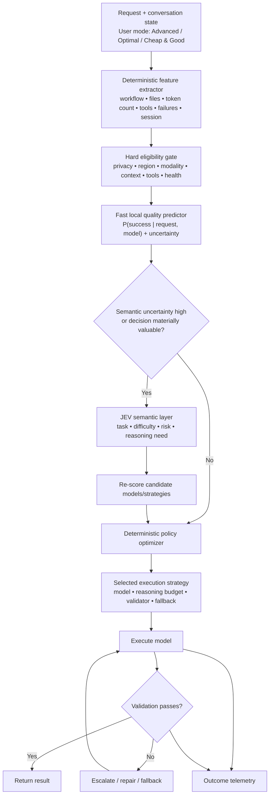
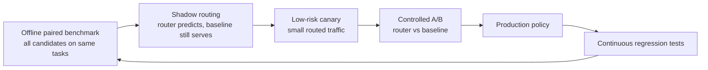
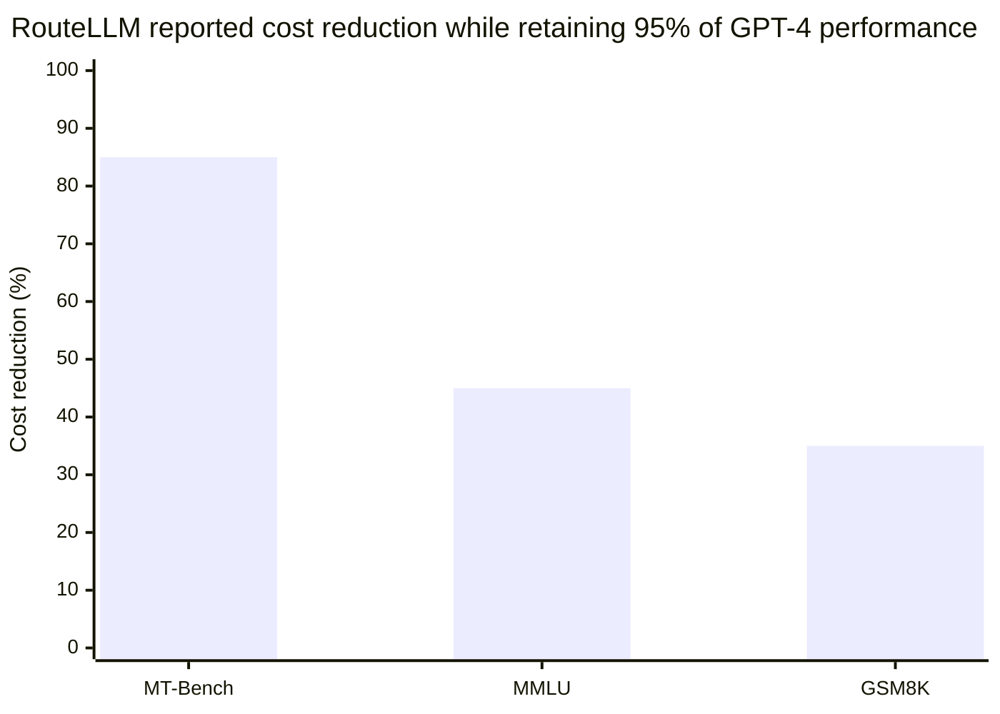
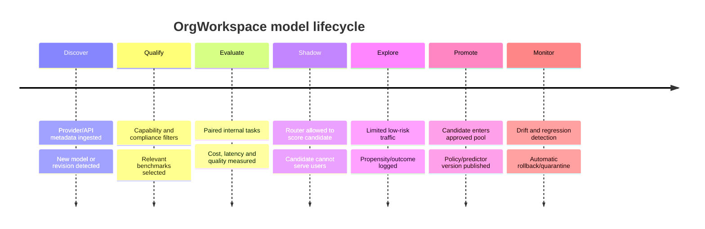
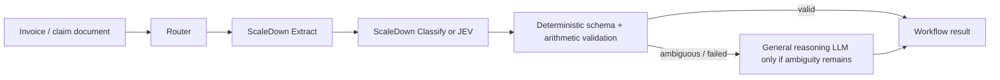
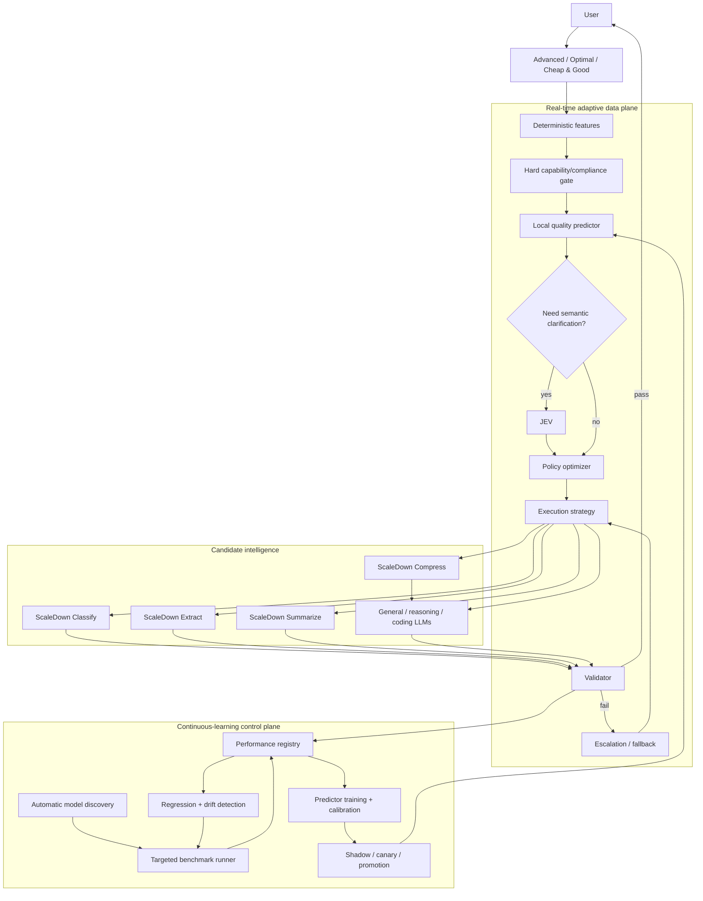

# OrgWorkspace Smart Model Selection Engine: Dynamic, Efficient, and Evidence-Driven Architecture

## Executive summary

OrgWorkspace has a strong case for building a **Smart Model Selection Engine**, but the highest-value architecture is not an LLM that simply reads a request and guesses which model to use, nor is it a static lookup table populated by periodic benchmarks.

The recommended design is a **hybrid adaptive router**:

```text
User preference
Advanced / Optimal / Cheap & Good
        ↓
Hard deterministic constraints
        ↓
Per-request feature extraction
        ↓
Fast learned quality predictor
        ↓
Selective JEV semantic analysis
        ↓
Deterministic policy optimizer
        ↓
Model + reasoning budget + fallback + validator
        ↓
Execution → validation → escalation if needed
```

The key architectural principle is to separate three kinds of intelligence:

| Layer | Responsibility | Recommended mechanism |
|---|---|---|
| **Semantic intelligence** | What does this request actually require? | Deterministic features + selective JEV |
| **Performance intelligence** | Which models are likely to succeed on this specific request? | Learned predictor trained on OrgWorkspace outcomes |
| **Decision intelligence** | Given the user's mode, which execution strategy should we choose? | Deterministic policy optimizer |

This architecture remains **dynamic on every request**. The control plane continuously discovers and evaluates models, but it does not dictate a fixed route. At runtime, current request characteristics, conversation state, model health, prices, latency, user preference and predicted success all affect the selection.

There is strong evidence that the general idea is commercially viable. Microsoft Foundry now uses a purpose-built ML router rather than an LLM and exposes three modes—Quality, Balanced and Cost—very similar to OrgWorkspace's proposed **Advanced, Optimal and Cheap & Good**. Microsoft explicitly describes its router as a lightweight ML model trained on hundreds of thousands of examples, with session affinity and dynamic prompt-difficulty selection. citeturn21view4turn22view1 Google exposes equivalent `PRIORITIZE_QUALITY`, `BALANCED`, and `PRIORITIZE_COST` routing preferences. citeturn23view3 AWS says its Intelligent Prompt Routing can reduce model cost by as much as 30% without compromising accuracy on the workloads it evaluated. citeturn22view0

Academic evidence is also substantial. RouteLLM demonstrated more than 2× cost savings with minimal quality degradation across its evaluated benchmarks; its public results at 95% of GPT-4 performance reported cost reductions exceeding 85% on MT-Bench, 45% on MMLU and 35% on GSM8K. citeturn20view10turn23view2 FrugalGPT showed that learned cascades could match its strongest individual LLM with up to 98% lower cost on the experiments reported in that paper. Those results involved older model generations and should be regarded as proof of the *routing principle*, not forecasts of OrgWorkspace savings. citeturn20view11

There is also now an especially relevant precedent: **OpenRouter's Jev Router already uses JEV to assess the task, difficulty and expected benefit of stronger models, then combines those signals with cost policy and model restrictions**. It can retain or switch models across turns and vary reasoning effort. citeturn21view3turn22view3 This validates JEV as a routing component, but it also clarifies where OrgWorkspace can differentiate: **OrgWorkspace should combine JEV with its own task-specific performance data, validators, business policies and learned quality predictor rather than letting JEV independently select the model.**

My overall recommendation is therefore:

**Build the router—but treat model selection as an optimization problem over execution strategies rather than a model-ranking problem.**

An execution strategy might be:

> `Model B → deterministic validator → Model A only if validation fails`

rather than simply:

> `Use Model A`.

That distinction is likely to produce much larger cost savings.

For OrgWorkspace specifically:

**Advanced** should maximize the conservative estimate of successful task completion, with cost mainly a tie-breaker.

**Optimal** should minimize expected *total cost per successful task* subject to a high quality threshold.

**Cheap & Good** should find the least expensive strategy meeting a defined acceptable-quality floor, rather than blindly selecting the cheapest model.

JEV should be invoked **selectively**, when semantic ambiguity is high enough that it can alter the route. At its current $0.042 per million input tokens, even 100,000 JEV routing calls carrying 2,000 tokens apiece would cost only about **$8.40 in JEV model input charges**; at a 30% invocation rate, that becomes about **$2.52**. citeturn20view1 The more material concern is therefore **serial latency**, not JEV's token cost. OpenRouter currently reports a roughly 0.10-second P50 for Jev 1.14 at its best provider, though production latency will vary. citeturn20view1

The strongest initial business case is not "cheaper tokens." It is:

> **higher gross margin and reliability by spending frontier-model money only where frontier-model capability materially increases the probability of successful task completion.**

That is especially compelling for OrgWorkspace because agent-building, UI-building, BVR and document workflows have fundamentally different model requirements.

## Model inventory and where the specialized models fit

As of October 26, 2026, JEV and ScaleDown represent two related but distinct categories of specialized models. JEV is primarily a **structured decision model**; ScaleDown has separated common AI operations into **classification, extraction, summarization and context compression**.

### Current capabilities and economics

| Model | Primary capability | Interface | Current price | Context | Best role in OrgWorkspace |
|---|---|---|---:|---:|---|
| **Jev 1.14** | Typed probabilistic decisions | TypeSafe System One API / OpenRouter Decisions | $0.042/M input, output free | TypeSafe default lower limits; 262K opt-in/direct danger-zone; OpenRouter lists 262K | Semantic routing signals, ambiguity resolution, BVR semantic judgments, gating |
| **ScaleDown Classify-1** | Rubric/label classification with probabilities | ScaleDown Decisions/Classify API; OpenRouter Decisions | $0.04/M via OpenRouter; ScaleDown base rate $0.05/M | 1M | Intent, task family, document routing, fixed-label decisions |
| **ScaleDown Extract** | Description-driven structured/entity extraction | Direct OpenAI-compatible API; OpenRouter | $0.04/M via OpenRouter; $0.05/M direct base | 1M | Invoices, claims, contracts, structured document fields |
| **ScaleDown Summarize** | Abstractive summarization | OpenAI-compatible chat API / OpenRouter | $0.04/M via OpenRouter; $0.05/M direct base | 1M | Human-readable summaries, older session condensation, document digests |
| **ScaleDown Compress** | Query-aware context reduction | ScaleDown `/compress/raw/` | ScaleDown catalog base rate $0.05/M; verify contracted billing | 1M catalog limit | Compress large retrieved/tool context before expensive LLM calls |

Jev 1.14 returns structured decisions rather than free-form prose and is specifically positioned for routing and classification. OpenRouter currently lists a 262,144-token context and $0.042/M input price. citeturn20view1 TypeSafe's direct documentation is more conservative: ordinary calls operate with separate request/question limits, while 262K requires an explicit long-context "danger zone" header; TypeSafe warns long-context mode is slower and less accurate. It also recommends pinning a version such as `jev-1.14.0` when thresholds have been calibrated, because moving aliases can change behavior. citeturn21view0

A useful characteristic for routing is that Jev ingests a common `state` once and evaluates multiple questions against it in parallel. That means a single call can ask, for example, *task family*, *complexity*, *need for deep reasoning*, *risk level*, and *whether specialist extraction is appropriate*, instead of making five sequential model calls. citeturn21view0

I would exploit that directly:

```json
{
  "state": {
    "request": "...",
    "workflow": "agent-builder",
    "context_tokens": 38000,
    "previous_attempts": 1
  },
  "questions": {
    "task_family": {
      "type": "choice",
      "criteria": {
        "coding": "...",
        "debugging": "...",
        "planning": "...",
        "document_extraction": "...",
        "classification": "..."
      }
    },
    "requires_deep_reasoning": {
      "type": "noul",
      "instructions": "Does successful completion require multi-step reasoning?"
    },
    "complexity": {
      "type": "score",
      "scale": ["trivial", "low", "medium", "high", "very_high"]
    }
  }
}
```

JEV's output should become **features for the router**, not instructions such as `"use_model": "X"`.

That distinction is important because TypeSafe knows how JEV behaves, but JEV does not inherently know that, for example, Model X has completed 96.7% of OrgWorkspace's multi-agent-building regression suite while Model Y has completed only 88.4%. That information belongs to OrgWorkspace.

### ScaleDown's models should be candidates, not the router itself

ScaleDown Classify-1 has a similar structured-decisions interface to JEV through OpenRouter, including choice, yes/no and ordered-score tasks, at $0.04/M input and a listed 1M-token context. citeturn20view3 It is a credible competitor to JEV for narrow fixed-rubric classification and should be evaluated head-to-head rather than assumed inferior.

Extract is particularly attractive for document workflows. The direct ScaleDown interface supports JSON-schema extraction, including nested objects and arrays; its model catalog lists a 1M context and $0.05/M direct base price. citeturn21view1 OpenRouter's version is currently $0.04/M and also handles text, images and PDFs, but OpenRouter explicitly says that its route does **not** expose `response_format` enforcement or tool calling. citeturn20view4 For invoice/claims workflows, therefore, the direct ScaleDown interface currently gives OrgWorkspace more schema control.

Summarize provides abstractive summaries of long text/documents. OpenRouter lists $0.04/M input, 1M context and up to 4,000 output tokens; the direct compatibility API currently defaults to and caps `max_tokens` at 1,000 unless a higher limit is arranged. citeturn20view5turn21view1 It is a good fit for *human-readable condensation*, but I would not let a summary become the canonical memory for long-running UI or agent-building sessions.

Compress has a different purpose. It sits between retrieval/context assembly and the downstream LLM, returning reduced context while leaving the user's prompt unchanged. ScaleDown reports typical compression in the 50–70% range and positions it for RAG, long-document QA, conversation history and code analysis. citeturn21view2turn22view4 The 50–70% figure is a **vendor-reported typical range**, not a guarantee of equal downstream task quality.

For OrgWorkspace, I would be conservative:

| Workload | JEV | Classify | Extract | Summarize | Compress |
|---|---|---|---|---|---|
| Agent builder | **High value** | Medium | Low | Medium | Medium, mainly tool/log context |
| UI builder | **High value for routing** | Low–medium | Low | Medium | Medium for code/retrieval context |
| BVR | **High for semantic questions** | High for fixed taxonomies | Medium | Low | Low |
| Invoice/claims documents | Medium | High | **Very high** | High | High for downstream context |
| Long conversation memory | Medium | Low | Low | High | **Use selectively, not as sole memory** |

The most important architectural rule is: **specialized models should bypass generic routing when the operation is already semantically known.**

If the workflow node is explicitly `invoice.extract_fields`, there is little reason to ask JEV whether the task is extraction. The router can directly compare approved extractors.

If the user says:

> "Take these insurance documents, determine what matters, update the claim workflow and explain any problems,"

then semantic decomposition has substantial value—and JEV becomes useful.

ScaleDown's own current benchmark suite reports notable performance and latency advantages against averages of selected general-purpose models: for its OpenAI comparison it reports +5.40% on CLINC OOS classification, +14.40% on CUAD extraction, +8.83% on QMSum summarization, and +6.23% for compression on a FinanceBench downstream task; reported ScaleDown latencies were 647 ms, 918 ms, 1,426 ms and 2,658 ms respectively. These are **ScaleDown-run benchmarks using its chosen datasets and methodology**, so they are evidence that specialization is worth testing, not sufficient evidence to replace OrgWorkspace's current models. citeturn23view0turn23view1

```mermaid
xychart-beta
    title "ScaleDown vendor benchmark latency vs selected OpenAI-model average"
    x-axis ["Classify", "Extract", "Summarize", "Compress"]
    y-axis "Response latency (ms)" 0 --> 5500
    bar [647, 918, 1426, 2658]
    bar [1661, 2995, 3807, 4910]
```



In the chart, the **first bar** for each task is ScaleDown and the **second** is the reported average across GPT-5.5, GPT-5.4 Mini and GPT-5.4 Nano. These measurements come from ScaleDown rather than an independent evaluator. citeturn23view0

## Recommended architecture

The most important correction to a conventional control-plane/data-plane design is this:

> **The control plane should learn the landscape; the data plane should still decide dynamically.**

A cached routing table should never be the final intelligence layer. It should contain model capabilities, priors, policy rules and emergency defaults.

### Runtime architecture



This architecture avoids the two extremes we discussed earlier:

**Extreme one:** Ask a powerful LLM to decide the route on every request. This increases cost, latency, non-determinism and audit difficulty.

**Extreme two:** Benchmark models in the background and use a static map such as `coding → Model A`. That is cheap but not genuinely adaptive.

The hybrid design evaluates **every request dynamically**, but most of the runtime intelligence is computationally cheap.

### The data plane

The synchronous path should have five layers.

**Deterministic feature extraction** is essentially free relative to LLM inference. OrgWorkspace already knows many of the strongest signals: current product area, workflow node, files attached, context size, tool schemas, previous failures, number of edited files/components, current model, session age and requested output type.

**Hard filtering** must happen before quality ranking. A model that lacks the necessary modality, context window, tool capabilities, tenant approval or geographical eligibility should never reach the optimizer.

**A learned quality predictor** estimates something like:

\[
\hat q_m(x)=P(\text{verified task success}\mid x,m)
\]

where \(x\) represents this exact task and \(m\) a candidate model.

A lightweight gradient-boosted tree, calibrated logistic model or small neural classifier can perform this prediction in-process. The initial implementation does not need a generative LLM.

**JEV is selectively invoked** when the quality predictor's uncertainty is high or semantic understanding could materially change the route.

**The deterministic policy optimizer** transforms all of those signals into the execution strategy.

The runtime selector should preferably live **inside the existing inference gateway/process** rather than behind another synchronous microservice call. That removes network latency from the most common path.

### The control plane

```mermaid
flowchart LR
    D["Model discovery<br/>OpenRouter / TypeSafe / ScaleDown"]
    C["Capability + price catalog"]
    B["Targeted benchmark runner"]
    P["Performance registry"]
    T["Train + calibrate quality predictor"]
    S["Shadow evaluation"]
    K["Controlled canary / exploration"]
    G["Promotion gate"]
    PUB["Publish approved pool + predictor"]
    LIVE["Runtime outcomes"]
    R["Regression detector"]

    D --> C
    C --> B
    B --> P
    P --> T
    T --> S
    S --> K
    K --> G
    G --> PUB
    PUB --> LIVE
    LIVE --> P
    LIVE --> R
    R --> B
```



Automatic discovery is feasible. OpenRouter exposes a standardized Models API with model metadata designed for production integration, while TypeSafe and ScaleDown expose model-listing APIs of their own. citeturn23view5turn20view0turn21view1

What cannot safely be automated from metadata is **quality**.

A newly discovered model might claim:

```text
vision = yes
tools = yes
1M context
$0.20/M
```

but none of that tells you whether it builds OrgWorkspace agents correctly.

Therefore:

> **Model metadata determines eligibility. OrgWorkspace evidence determines quality.**

### JEV should be gated by value, not called blindly

A useful approximation is:

\[
\text{Call JEV if Expected Routing Improvement}
>
\text{Latency Cost}+\text{JEV Monetary Cost}
\]

At current Jev pricing, its monetary term is often tiny. citeturn20view1 The real question is whether adding roughly another remote inference hop improves the final choice enough to justify its latency.

Good JEV candidates:

| Situation | Invoke JEV? |
|---|---|
| Explicit workflow node `extract_invoice` | No |
| "Change this button to red" | Usually no |
| Ambiguous user request combining coding and business logic | Yes |
| Complex agent-builder request with several possible strategies | Yes |
| Current predictor gives Model A 91%, Model B 90% with low uncertainty | Probably no |
| Predictor gives Model A 78–96%, Model B 80–94% because task semantics are unclear | Yes |
| BVR request where interpretation determines risk level | Often yes |
| Hard numeric rule `amount > 10000` | No AI at all |

Jev 1.14's current OpenRouter listing reports a best-provider P50 around 0.10 seconds. citeturn20view1 That is fast enough to be plausible as a selective routing component but still meaningful for very low-latency interaction. Some of its latency can also be hidden by running it concurrently with context preparation, retrieval or model-candidate preflight.

### Session continuity must be a routing variable

Agent- and UI-building are not isolated prompts. Model switching itself can have a cost.

The router therefore needs:

\[
\text{SwitchingPenalty}(m_\text{current}\rightarrow m_\text{candidate})
\]

based on factors such as prompt-cache opportunity, project continuity, session history and how much state must be reconstructed.

Microsoft's router uses session affinity for exactly this class of reason: subsequent requests can preferentially stay with the previously serving model when it remains eligible, improving behavioral continuity and prompt-cache opportunity. citeturn21view4

This should not mean "never switch." It means:

> **Switch only when the predicted benefit exceeds the cost of switching.**

### Architecture alternatives and trade-offs

| Architecture | Dynamic? | Router latency | Accuracy potential | Operational complexity | Recommendation |
|---|---:|---:|---:|---:|---|
| Static task → model rules | Low | Extremely low | Medium | Low | Keep as deterministic fast path only |
| Background benchmark + cached winner | Low–medium | Extremely low | Medium | Low | Useful baseline, not end-state |
| JEV selects model every request | High | Remote-call overhead every request | High potential | Medium | Too dependent on one decision model |
| Local learned predictor | High | Very low | High with enough data | Medium | Core runtime component |
| **Local predictor + selective JEV + optimizer** | **High** | **Low normally; moderate when JEV invoked** | **Very high potential** | **Medium–high** | **Recommended** |
| Multi-LLM committee for every request | High | Very high | Potentially high | Very high | Advanced exceptional tasks only |

OpenRouter's new Jev Router is direct evidence that a JEV-based dynamic approach is practical: it currently uses Jev to assess task needs, difficulty and the value of stronger models; then it applies cost policy and candidate restrictions and can adapt model/effort across turns. citeturn21view3turn22view3 OrgWorkspace's architecture should go further by replacing generic ecosystem priors with **its own verified performance estimates**.

## Dynamic routing algorithms

The router should optimize **task completion**, not model prestige.

A single global "Model A = 94, Model B = 91" leaderboard is not enough. Recent research also cautions that mixed workloads cannot always be represented by one scalar quality score: utility and security-sensitive behavior can prefer different models and budgets. citeturn20view12

OrgWorkspace therefore needs a task-conditioned quality vector.

For example:

```text
Model A
  agent_planning       0.96
  workflow_tool_use    0.94
  UI_generation        0.88
  UI_debugging         0.95
  invoice_extraction   0.86
  long_context         0.92
  safety               0.98
```

### Hard constraints first

Before predicting quality, remove impossible or unacceptable candidates:

\[
M_\text{eligible} =
M_\text{all}
\cap C_\text{capability}
\cap C_\text{privacy}
\cap C_\text{region}
\cap C_\text{context}
\cap C_\text{availability}
\]

These constraints should **never** be soft weights.

For example, a privacy-ineligible model with a projected 99.5% success rate remains ineligible.

This mirrors production routers: OpenRouter's Auto Router honors model/provider restrictions and ZDR requirements, while Microsoft advises using approved model subsets as a compliance gate rather than allowing the router to override security policy. citeturn23view4turn22view2

### Quality prediction

For every eligible model, calculate:

\[
\hat q_m=P(\text{successful completion}\mid x,m)
\]

and an uncertainty interval.

Do not select based solely on the point estimate.

If:

```text
Model A:
predicted success = 96%
95% uncertainty interval = 88–99%

Model B:
predicted success = 94%
95% interval = 93–95%
```

then B may actually be the safer Advanced choice.

A useful score is a conservative lower bound:

\[
Q^\text{LCB}_m=\hat q_m-k\sigma_m
\]

where \(k\) increases for higher-risk tasks.

That prevents a newly released model with only twenty successful evaluation examples from immediately replacing a model backed by thousands of observations.

### The three user modes

The user's selection should alter **the optimizer**, not replace the intelligence underneath it.

| Mode | Objective | Practical behavior |
|---|---|---|
| **Advanced** | Maximize conservative predicted success | Use strongest verified strategy; treat cost mainly as tie-breaker |
| **Optimal** | Minimize expected total cost subject to high quality/SLO | Most sophisticated cost-quality trade-off |
| **Cheap & Good** | Minimize cost subject to acceptable quality floor | Favor small/specialized models and validated cascades |

This user experience has strong industry precedent. Microsoft exposes Quality, Balanced and Cost modes, and Google exposes Prioritize Quality, Balanced and Prioritize Cost. citeturn22view1turn23view3

For OrgWorkspace, I would make the semantics slightly more rigorous.

**Advanced**

\[
\max_s Q^\text{LCB}(s,x)
\]

subject to privacy, capability, maximum acceptable latency and any absolute budget cap.

If several strategies are within a tiny quality tolerance—say one percentage point—choose the cheaper/faster one.

**Optimal**

\[
\min_s E[\text{TotalCost}(s,x)]
\]

subject to:

\[
Q^\text{LCB}(s,x)\ge Q_\text{optimal}
\]

and:

\[
P(Latency\le SLO)\ge L_\text{target}
\]

**Cheap & Good**

\[
\min_s E[\text{TotalCost}(s,x)]
\]

subject to:

\[
Q^\text{LCB}(s,x)\ge Q_\text{minimum}
\]

The quality floors should be **different by task class and risk**, not universal.

For example, 90% might be acceptable for drafting UI copy but unacceptable for deciding whether an automated approval workflow is safe to execute.

### Expected recovery cost is more important than model price

This is one of the most important concepts for the entire engine.

Suppose:

| Strategy | First-call cost | Success probability | Failure recovery |
|---|---:|---:|---|
| Frontier immediately | $0.040 | 96% | $0.010 |
| Efficient model first | $0.010 | 90% | $0.040 frontier |
| Specialist + validator | $0.004 | 95% | $0.040 frontier |

The router should estimate:

\[
ERC(s)
=
C_\text{initial}
+
C_\text{validation}
+
P_\text{failure}\times C_\text{recovery}
\]

For the efficient-first example, assuming $0.001 validation:

\[
ERC = 0.010+0.001+0.10(0.040)=\$0.015
\]

The frontier-first strategy costs approximately $0.040 before its own failure recovery.

Therefore, even though the efficient model is individually worse, **the cascade may have a much better expected economic outcome**.

This is the same broad principle explored by FrugalGPT's learned LLM cascades. citeturn20view11

But it works only where failure can be detected reliably.

Strong cascade candidates:

| Task | Validation quality | Cascade suitability |
|---|---:|---:|
| JSON/schema extraction | Excellent | Very high |
| Code compilation/tests | Excellent | High |
| Agent workflow schema | Excellent | High |
| Tool-call argument validation | High | High |
| BVR with known golden rules | High | High |
| Subjective UI aesthetics | Weak | Low |
| Strategic brainstorming | Weak | Low |

### Routing pseudocode

```python
def route(request, mode, session, registry, predictor):
    features = extract_deterministic_features(
        request=request,
        session=session
    )

    # Never let probabilistic routing override hard policy.
    candidates = [
        model for model in registry.models
        if satisfies_capabilities(model, features)
        and satisfies_context(model, features)
        and satisfies_tenant_policy(model, request.tenant)
        and satisfies_region(model, request.tenant)
        and model.is_healthy
    ]

    if not candidates:
        return safe_fallback_or_fail_closed(request)

    predictions = predictor.predict(
        features=features,
        candidates=candidates
    )

    # JEV is an optional semantic sensor, not the final authority.
    if should_invoke_jev(
        prediction_uncertainty=predictions.uncertainty,
        task_ambiguity=features.semantic_ambiguity,
        request_risk=features.risk,
        possible_route_difference=predictions.route_spread,
        latency_budget=request.latency_budget
    ):
        semantic = call_jev(
            state=build_semantic_state(request, session),
            questions=ROUTING_QUESTIONS
        )

        features = merge_semantic_features(features, semantic)

        predictions = predictor.predict(
            features=features,
            candidates=candidates
        )

    strategies = create_strategies(
        candidates=candidates,
        predictions=predictions,
        validators=available_validators(features),
        fallbacks=eligible_fallbacks(candidates),
        current_model=session.current_model
    )

    for strategy in strategies:
        strategy.expected_recovery_cost = estimate_recovery_cost(
            strategy,
            features
        )

        strategy.quality_lcb = conservative_quality_bound(
            strategy,
            features
        )

        strategy.switching_penalty = model_switch_penalty(
            current=session.current_model,
            candidate=strategy.primary_model,
            session=session
        )

    feasible = apply_mode_constraints(
        strategies=strategies,
        mode=mode,
        task_risk=features.risk
    )

    return optimize(feasible, mode)
```

Execution then becomes:

```python
def execute(strategy, request):
    result = call_model(strategy.primary_model, request)

    validation = run_validator(
        strategy.validation_profile,
        result
    )

    if validation.passed:
        log_verified_outcome(strategy, result, validation)
        return result

    for fallback in strategy.fallback_chain:
        repaired = call_model(
            fallback,
            build_repair_request(request, result, validation)
        )

        validation = run_validator(
            strategy.validation_profile,
            repaired
        )

        if validation.passed:
            log_verified_outcome(
                strategy,
                repaired,
                validation,
                escalated=True
            )
            return repaired

    return escalate_to_human_or_strict_failure_policy()
```

### A realistic hypothetical decision

Consider:

> "The claims portal works, but approval sometimes modifies the wrong claim after users edit two records in different tabs. Find the problem and fix it without changing our approval rules."

The deterministic system already knows:

```text
product = UI builder
existing code = yes
debugging = likely
files affected = unknown
business rules = relevant
previous state = present
```

JEV might add:

```text
primary task          debugging       0.94
cross-state reasoning needed          true  0.91
business-rule risk    high            0.88
simple local edit     false           0.86
```

Those probabilities are semantic signals.

The OrgWorkspace predictor might then estimate, hypothetically:

| Candidate | Predicted success | Conservative quality | Expected cost | p95 latency |
|---|---:|---:|---:|---:|
| Strong Model A | 96% | 94% | $0.055 | 14 s |
| Model B | 94% | 92% | $0.020 | 7 s |
| Model C | 82% | 78% | $0.006 | 3 s |

Then:

**Advanced → A**

**Optimal → B**, assuming 92% conservative success meets the target.

**Cheap & Good → B or a C→B cascade**, depending on whether the code-test validator can reliably identify C's failures.

That is the type of routing intelligence we originally envisioned: **dynamic, deterministic at the policy level, statistically informed, and semantically assisted by JEV.**

## Evaluation and business-value validation

The Model Selection Engine should not be approved because it looks clever architecturally. It should be approved only if it improves **cost per verified successful task, time to successful completion, or both**.

### Define success by workload

Using one benchmark accuracy number would be a serious mistake.

| OrgWorkspace workload | Primary success definition |
|---|---|
| **Agent building** | Valid workflow graph, correct tools, successful execution scenarios, no broken dependencies |
| **UI building** | Build/test success, required interactions work, requested constraints remain satisfied |
| **BVR** | Correct semantic interpretation, critical false-approval rate, calibration; deterministic rules evaluated separately |
| **Document extraction** | Field-level precision/recall/F1, critical-field exact match, schema validity |
| **Long-running sessions** | Requirement retention, rejected-option retention, successful continuation after many turns |
| **Tool orchestration** | Correct tool selection/arguments, successful completion, recovery from tool errors |

For BVR, exact calculations and explicit policy thresholds should remain ordinary code. AI evaluation belongs only around genuinely semantic interpretation.

For UI quality, automated build tests should be supplemented by a human or appropriately validated visual-quality evaluation because "looks good" cannot reliably be inferred from successful compilation.

### Core metrics

I would make the primary dashboard show four numbers:

\[
\textbf{Verified Task Success Rate}
\]

\[
\textbf{Cost Per Verified Success}
=
\frac{\text{all model + router + validator + retry cost}}
{\text{verified successes}}
\]

\[
\textbf{p50 / p95 Time To Successful Completion}
\]

\[
\textbf{Critical Failure Rate}
\]

Secondary metrics should include first-pass success, escalation rate, retry cost, wasted-token ratio, router latency, JEV invocation rate, model-switch rate, prompt-cache hit opportunity, prediction calibration, user correction rate and human override rate.

The router should also be measured against its own predictions. If it says Model B has an 80% probability of success for 1,000 tasks, roughly 800 should succeed in that group. Otherwise its probabilities should not be trusted for policy optimization.

### Evaluation datasets

I would build the first internal corpus around roughly **2,000 representative tasks**, approximately 500 from each major OrgWorkspace family:

| Family | Initial evaluation cases | Important difficult cases |
|---|---:|---|
| Agent building | ~500 | Multi-agent dependencies, failed tools, workflow repair |
| UI building | ~500 | Multi-file changes, debugging, long-session modifications |
| BVR | ~500 | Ambiguous language, boundary cases, false-approval traps |
| Documents | ~500 | Scans, missing fields, tables, inconsistent invoices/contracts |

This is not a statistically universal requirement; it is a practical evaluation starting point.

For an ordinary independent two-proportion test, approximately **681 observations per arm** would be required to distinguish an 85% success rate from 90% at 5% two-sided significance and 80% power. Detecting 80% versus 85% requires about **903 per arm**. A paired evaluation—where the same tasks are run through each candidate—can be more efficient because outcomes are correlated.

Rare but severe failures need dedicated adversarial suites rather than hoping they appear often enough in random traffic.

Public datasets are useful for initialization, but OrgWorkspace data should dominate promotion decisions. ScaleDown itself evaluates Classify on CLINC OOS, Extract on CUAD, Summarize on QMSum and Compress through downstream FinanceBench performance; those can be useful sanity checks but do not resemble the entire OrgWorkspace workload. citeturn23view0

### Evaluation ladder

The safest progression is:



**Offline paired evaluation** is particularly important because normal production logs contain a fundamental counterfactual problem: after Model A served a request, you do not know how Model B would have performed.

**Shadow mode** tests routing latency, selection distributions and policy behavior without exposing users to new routes.

**Canary exploration** should be restricted to low-risk tasks where mistakes are recoverable.

High-risk BVR/approval workloads should require offline qualification before any production exploration.

### Baselines

OrgWorkspace should compare at least:

| Baseline | Why |
|---|---|
| Current fixed model strategy | Determines whether routing adds any value |
| Cheapest approved fixed model | Economic lower bound |
| Strongest approved fixed model | Quality upper reference |
| OpenRouter Auto Router | External adaptive-router baseline |
| OpenRouter Jev Router | JEV-based routing baseline |
| OrgWorkspace predictor without JEV | Measures JEV's incremental value |
| Full OrgWorkspace hybrid engine | Proposed system |

OpenRouter Auto currently classifies requests into roughly 30 task types and uses trailing seven-day market spend patterns plus capabilities and cost tier to route dynamically. citeturn23view4 That makes it a useful benchmark—but OrgWorkspace's advantage should be **domain-specific verified outcomes rather than market-spend popularity**.

### Cost and latency business case

The routing layer itself can be cheap.

At Jev 1.14's current $0.042/M input price: citeturn20view1

| Monthly requests | JEV invocation rate | JEV input/request | Approx. JEV cost |
|---:|---:|---:|---:|
| 100,000 | 30% | 2,000 tokens | **$2.52** |
| 100,000 | 100% | 2,000 tokens | **$8.40** |

This makes JEV's direct inference price almost irrelevant compared with expensive downstream generation for many workloads.

Its latency is not irrelevant, so the target architecture should aim for something like:

| Runtime path | Proposed engineering target |
|---|---:|
| Feature extraction + constraints | < 2–3 ms |
| Local quality prediction | < 5 ms |
| Optimizer | < 1 ms |
| **No-JEV route** | **single-digit milliseconds in-process** |
| JEV route | Adds remote inference/network latency |
| Downstream LLM | Often orders of magnitude greater than local routing |

Those figures are **design targets**, not measurements.

The business justification should use actual monthly model spend. For illustration, if successful routing reduces inference spend by 30% while quality remains non-inferior:

| Current routing-eligible monthly spend | 30% gross inference reduction |
|---:|---:|
| $2,500 | $750/month |
| $25,000 | $7,500/month |
| $250,000 | $75,000/month |

AWS's published claim of up to 30% cost reduction from Intelligent Prompt Routing shows that this magnitude is plausible for some heterogeneous workloads, but it is not a forecast for OrgWorkspace. citeturn22view0

The full ROI equation should be:

\[
\text{Net Benefit}=
C_\text{baseline inference}
+C_\text{avoided retries}
+C_\text{avoided support/rework}
-
C_\text{routed inference}
-
C_\text{router}
-
C_\text{validation}
-
C_\text{evaluation/operations}
\]

The most honest KPI is therefore:

> **Cost per verified successful task**, not cost per token.

A router that saves 40% of tokens but creates 20% more retries is probably a bad router.

### Research evidence for the cost-quality curve

RouteLLM's published benchmark results show the underlying opportunity clearly:



The MT-Bench figure was reported as **over** 85%; 85 is used as the chart floor for readability. These experiments used GPT-4-era models and benchmark workloads, so they establish that routing can shift the quality-cost frontier—not that OrgWorkspace will reproduce those percentages. citeturn23view2

## Operations and continuous model lifecycle

The objection that "a new model launches every day" is exactly why this system should not be manually maintained.

But there must be a distinction between **automated discovery** and **automated trust**.

### Model lifecycle



OpenRouter's standardized Models API can automatically feed identifiers, capabilities and metadata into this lifecycle. citeturn23view5 TypeSafe's model endpoint exposes current aliases/releases, and ScaleDown similarly exposes a model catalog with modalities, context and pricing. citeturn20view0turn21view1

### Targeted benchmarking rather than benchmarking everything

A new vision model does not need to run 2,000 text-only BVR cases.

A newly discovered model should first be mapped to plausible task families:

```text
New model
  ↓
Capabilities:
  code = yes
  tools = yes
  vision = yes
  1M context
  ↓
Relevant suites:
  agent builder
  UI builder
  long-context
  document vision
  ↓
Irrelevant suites skipped
```

This keeps evaluation cost manageable.

### Performance registry

The registry needs more than a model name and global score.

```json
{
  "model": "provider/model-version",
  "evaluation_version": "ui-debug-v6",
  "task_family": "ui_debugging",
  "difficulty_bucket": "high",
  "sample_count": 824,
  "verified_success_rate": 0.947,
  "calibrated_success_estimate": 0.939,
  "critical_failure_rate": 0.006,
  "average_task_cost_usd": 0.031,
  "p50_latency_ms": 5100,
  "p95_latency_ms": 11200,
  "tool_success_rate": 0.963,
  "last_regression_state": "pass"
}
```

The important data asset is not the model catalog. It is this history of **what models actually accomplished in OrgWorkspace**.

### Detecting silent model changes

Model names can be mutable. TypeSafe explicitly warns that aliases can move and recommends pinning a version when confidence thresholds have been calibrated. citeturn21view0

OrgWorkspace should therefore record:

```text
model identifier
provider
exact revision if available
evaluation version
prompt/template version
tool version
provider settings
date/time
observed latency
cost
validator result
```

A model is re-evaluated when any of these materially changes.

Regression detection should look for both:

**absolute regression**

> UI task success fell from 95% to 90%.

and **relative regression**

> The model is still at 95%, but a cheaper model is now at 96%.

The second case should also alter routing.

### Safe exploration solves selection bias

A learning router creates a subtle feedback problem.

Suppose it believes Model A is best and therefore sends 95% of tasks to A.

It then collects huge amounts of evidence about A but almost none about B.

Eventually:

> "A has the most evidence that it works."

becomes self-fulfilling.

Contextual-bandit research addresses exactly this exploitation-versus-exploration problem, and contemporary routing work increasingly treats model selection as online decision-making rather than fixed classification. citeturn20view10turn20view12

I would not begin with a full bandit system, however.

Use:

```text
High-risk request
→ exploit validated best route only

Low-risk request
→ 95–99% exploit
→ small controlled exploration pool

Offline evaluation
→ broader candidate exploration
```

Every exploratory choice should log the selection probability, allowing later correction for biased sampling.

As the dataset matures, a contextual-bandit policy can replace parts of the manually controlled exploration layer.

### Model updates should not automatically reach production

The lifecycle should distinguish:

```text
DISCOVERED
   ↓
ELIGIBLE
   ↓
BENCHMARKED
   ↓
SHADOW-APPROVED
   ↓
CANARY-APPROVED
   ↓
PRODUCTION CANDIDATE
   ↓
DEFAULT / FALLBACK
```

A newly released model can therefore be recognized within minutes or hours without immediately affecting users.

This balances the user's two requirements:

**keep up with new models automatically**

without

**trusting unknown models automatically**.

## Evidence, precedent, and risk analysis

The most encouraging finding from this research is that the proposed OrgWorkspace design is not speculative in category. Multiple major platforms have independently converged on highly similar ideas.

### Existing systems and published evidence

| System / research | What it demonstrates | Reported result / relevant lesson |
|---|---|---|
| **Microsoft Foundry Model Router** | Purpose-built ML router; prompt difficulty; session affinity; Quality/Balanced/Cost modes | Strong architectural precedent for OrgWorkspace's three modes |
| **AWS Intelligent Prompt Routing** | Predict model performance per request | AWS reports up to 30% cost reduction without accuracy compromise |
| **Google Gemini Enterprise routing preference** | User/business can choose quality vs balanced vs cost | Exact UX precedent for Advanced/Optimal/Cheap |
| **OpenRouter Auto Router** | Dynamic model discovery via live market signals | Adapts model ranking from recent ecosystem usage |
| **OpenRouter Jev Router** | JEV can assess difficulty/value of stronger model and route model + effort | Direct validation of JEV's use in routing |
| **RouteLLM** | Learned router from preference data | >2× savings broadly; benchmark-specific 35–85%+ reductions at 95% strong-model quality |
| **FrugalGPT** | Learned cascades | Up to 98% reduction while matching best model in its reported experiments |
| **ScaleDown specialized suite** | Specialization can beat general models on narrow operations | Vendor reports large cost/latency gains on selected classification/extraction/summarization/compression benchmarks |

Microsoft's architecture is particularly important. Its router is explicitly **not a general LLM**; Microsoft describes it as a purpose-built ML model optimized for fast inference, trained on hundreds of thousands of examples covering QA, code, math, summarization, conversation and agentic workflows. It distinguishes easy from complex requests and can adapt its model subset dynamically. citeturn21view4

That strongly supports our proposed design:

> **JEV for semantic information + small learned model for performance prediction + deterministic optimizer**

rather than:

> **large LLM chooses another large LLM.**

AWS independently describes a similar objective: predict each candidate model's performance for the incoming request, then choose the model expected to deliver the desired response at the lowest cost. citeturn22view0

OpenRouter provides a third approach. Its Auto Router classifies tasks and uses trailing seven-day spend patterns to remain responsive to changing model preferences without manual curation. citeturn23view4 That is clever for a general marketplace. OrgWorkspace can potentially do better for its domain because it can replace *market popularity* with *verified OrgWorkspace success*.

And OpenRouter's Jev Router is arguably the closest current product to our concept: JEV assesses task requirements and difficulty; a policy chooses model and reasoning effort; the route can adapt over a conversation. citeturn21view3 OrgWorkspace's differentiator would be stronger deterministic business controls, specialist routing, task validators and proprietary outcome-based quality prediction.

### Key risks and mitigation

| Risk | Why it matters | Mitigation |
|---|---|---|
| **Routing latency** | A remote JEV call could slow fast requests | Deterministic fast paths; local predictor; invoke JEV only when decision value is high; parallelize with context assembly |
| **Router cost** | Validation/retries may erase inference savings | Optimize total cost per success, not token price; enforce strategy budgets |
| **Incorrect JEV semantics** | JEV is probabilistic | Treat as features, not authority; calibrate on OrgWorkspace data |
| **Selection bias** | Router learns mostly about models it already selects | Paired offline benchmarks + low-risk exploration + propensity logging |
| **Model drift** | Provider updates can change behavior | Version pinning, regression suite, canary promotion, automatic quarantine |
| **New-model cold start** | Metadata gives no quality evidence | Conservative prior, offline benchmark, shadow, controlled exploration |
| **Overfitting internal benchmarks** | Router may optimize test suite rather than reality | Rotating holdout sets, production metrics and adversarial cases |
| **False confidence** | Predicted 95% may be poorly calibrated | Calibration curves, Brier/ECE monitoring, lower-confidence-bound selection |
| **Session instability** | Constant model switching harms continuity | Switching penalty and session affinity |
| **Compression context loss** | Important old requirement may disappear | Preserve canonical history; compress only disposable/retrievable context |
| **Privacy/residency** | Router might pick an otherwise strong but disallowed model | Eligibility gate before scoring; never represent compliance as soft weight |
| **Single quality metric** | Safe, correct, attractive, fast can conflict | Maintain task-specific quality vector and hard safety floors |

The last risk deserves emphasis. A 2026 routing study specifically found that utility and security-sensitive workloads can prefer different model/budget configurations and argues against optimizing all requests against one scalar quality metric. citeturn20view12

For OrgWorkspace, "quality" should therefore resemble:

```text
Quality vector
├── functional correctness
├── requirement adherence
├── tool reliability
├── safety/policy compliance
├── context retention
├── format/schema correctness
└── user-rated usefulness
```

The optimizer can weight these differently by task, but critical dimensions can also be hard thresholds.

### Privacy implications of JEV and specialized models

TypeSafe states that Jev is not trained on customer requests/responses and documents enterprise zero-data-retention options. citeturn20view0 However, OrgWorkspace should still perform its own DPA, residency and provider review rather than inferring compliance solely from model marketing.

There is another practical constraint: OpenRouter's current Jev Router is available only in its global data region, so a tenant requiring in-region routing may not be able to use that hosted router directly. citeturn22view3 This is another argument for owning the OrgWorkspace policy layer and treating third-party routers/models as replaceable components.

### Where ScaleDown genuinely adds value

The research does **not** support the conclusion that ScaleDown should replace every generic model.

It supports a more interesting conclusion:

> **Specialization expands the action space available to the routing engine.**

Without specialists, the router asks:

```text
Which general-purpose LLM should solve this?
```

With them, it can ask:

```text
Does this task need a general LLM at all?
```

For a document workflow:



That is likely a bigger source of efficiency than merely choosing between two general-purpose LLMs.

Compress should be handled more carefully. ScaleDown reports 50–70% typical context reduction. citeturn22view4 But for OrgWorkspace's serious long-running agent/UI construction conversations, I would **never allow compressed context to replace canonical project memory**.

Use it for:

```text
large tool results
retrieved SharePoint/document chunks
logs
repository excerpts
search results
reproducible intermediate output
```

Do not make it the only copy of:

```text
system instructions
business rules
user-approved requirements
rejected design decisions
security constraints
canonical project state
```

That distinction preserves the serious iterative reasoning process you described earlier.

## Recommended pilot and MVP roadmap

The pilot should answer one question:

> **Can the hybrid router improve the quality-cost-latency frontier for actual OrgWorkspace work enough to justify its operational complexity?**

The goal should not initially be to route all production traffic.

### Pilot scope

Use the four main families already identified:

| Workload | Models/strategies to test | Why |
|---|---|---|
| Agent building | Current model + 2–3 general candidates + JEV-assisted routing | High variation in task difficulty |
| UI building | Current model + coding/design candidates + session-aware router | Tests long-running context and model stickiness |
| BVR | Deterministic rules + JEV + Classify-1 + approved reasoning model | Tests structured semantic decisions |
| Documents | ScaleDown Extract/Classify/Summarize vs current approach | Strong specialist-model opportunity |

I would place **Compress in shadow evaluation first**, rather than allowing it to modify canonical conversation context immediately.

### Router variants

Run four internal variants over the same evaluation corpus:

| Variant | Purpose |
|---|---|
| **A — Fixed baseline** | Existing production behavior |
| **B — Deterministic + local predictor** | Measures value of learned routing alone |
| **C — Predictor + selective JEV + optimizer** | Measures JEV's incremental contribution |
| **D — External router baseline** | OpenRouter Auto/Jev Router comparison |

This directly answers:

> **Is JEV actually helping enough to justify its latency?**

If C beats B on cost per verified success, quality, or hard-task routing, JEV earns its place.

If C performs the same as B, reduce the JEV invocation domain.

That makes the architecture evidence-driven rather than ideological.

### Proposed acceptance criteria

These should be refined after measuring the current baseline, but a sensible starting gate is:

| Area | Pilot gate |
|---|---|
| Overall verified quality | No more than ~1 percentage point below fixed strong-model baseline for Optimal |
| Advanced quality | Equal or better verified success on difficult tasks |
| Optimal economics | Target ≥20–30% lower cost per verified successful task |
| Cheap & Good economics | Target materially larger savings while maintaining agreed quality floor |
| Non-JEV routing overhead | p95 target <10 ms in-process |
| JEV utilization | Preferably limited to requests where semantic ambiguity changes candidate ranking |
| Critical BVR errors | No regression in false approvals |
| Privacy violations | Zero |
| Model capability violations | Zero |
| Unknown-model auto-promotion | Zero |
| Regression rollback | Automatic/quarantinable |
| Session continuity | No significant increase in repeated corrections or forgotten constraints |

These are **proposed product gates**, not externally established standards.

### Pilot cost model

Evaluation cost can be calculated directly:

\[
C_\text{eval}
=
N_\text{tasks}
\times
\sum_m C(m,\text{task})
+
C_\text{validators}
+
C_\text{JEV}
\]

As an illustrative scenario, 2,000 tasks run against four candidate strategies at an average $0.02 inference cost each would produce roughly **$160 of direct candidate-inference spend**, before validators, retries and especially expensive long-running agent/UI executions.

The real expense of the pilot is likely to be engineering and evaluation work, not JEV inference.

Whether the business case is strong therefore depends heavily on OrgWorkspace's scale.

At $2,500/month of routing-eligible inference expenditure, even a 30% reduction is only $750/month.

At $25,000/month, it becomes $7,500/month.

At $250,000/month, it becomes $75,000/month.

Cost optimization becomes increasingly compelling with volume, but even at lower spend the engine may still justify itself through **higher completion rates, premium Advanced-mode monetization, faster average responses and reduced model-vendor lock-in**.

### Milestone-based implementation roadmap

Rather than building the sophisticated adaptive system all at once, I would use strict capability gates.

**Foundation**

Build the unified model registry, provider metadata synchronization, exact cost telemetry, task taxonomy, deterministic capability/privacy filters, session identifiers and the three user-visible policies:

```text
Advanced
Optimal
Cheap & Good
```

At this point, routing decisions are fully observable even if the existing model still serves everything.

**Evaluation infrastructure**

Create the 2,000-case multi-workload benchmark suite, deterministic validators, cost/latency instrumentation and paired model runner.

This is arguably the most strategically valuable part of the project because every future model can then be evaluated automatically.

**Dynamic predictor**

Train the first lightweight quality predictor using benchmark outcomes. Keep the model simple and calibratable.

Runtime becomes:

```text
request
→ features
→ eligible candidates
→ predicted success
→ user-mode optimizer
```

Now the system is genuinely dynamic.

**Selective JEV**

Integrate JEV as a semantic sensor only where route uncertainty warrants it.

Run B versus C comparisons:

```text
predictor only
vs
predictor + JEV
```

Measure the incremental improvement directly.

**Strategy optimization**

Add validators and expected-recovery-cost cascades:

```text
cheap model
→ validate
→ stronger model only if needed
```

This is where significant economic improvement may emerge for extraction, coding and agent-schema tasks.

**Continuous model lifecycle**

Automate discovery, capability mapping, targeted benchmark selection, shadow qualification, model-regression monitoring and safe promotion.

New models now become candidates automatically without becoming trusted automatically.

**Controlled learning**

After substantial outcome data exists, introduce limited contextual-bandit exploration for low-risk traffic, model-specific personalization by task/tenant where justified, and dynamic reasoning-budget selection.

The architecture then becomes:



### Final recommendation

The research supports building the Smart Model Selection Engine, with one important framing change:

> **Do not build a "model selector." Build an adaptive execution-strategy optimizer.**

The actual system should decide:

```text
What does this request need?
        ↓
Which models are allowed?
        ↓
How likely is each strategy to succeed?
        ↓
Does JEV add useful semantic information?
        ↓
What does the user's Advanced / Optimal / Cheap & Good policy value?
        ↓
Should we call a specialist, a general LLM, or no LLM?
        ↓
Should we use one model or a validated cascade?
        ↓
How will we know that the result succeeded?
```

That approach solves the concern raised throughout this discussion.

It is **not static**: every request can produce a different strategy.

It is **not controlled entirely by an LLM**: hard policies and the final optimizer remain deterministic.

It can use **JEV where JEV is strongest**—fast semantic structured decisions—without entrusting it with knowledge it cannot possess about OrgWorkspace-specific model performance.

It can incorporate **ScaleDown specialists where a general model is unnecessary**, which may produce greater savings than general-model routing alone.

It can keep pace with new models through automated discovery and evaluation while preventing unknown models from silently reaching production.

And most importantly, it creates a compounding proprietary asset: a dataset showing **which models, reasoning budgets, specialists, validators and cascades actually work for OrgWorkspace tasks**.

That performance intelligence—not the routing `if` statement—is likely to become the durable value of the system.